# Переписка Исполнителя с Заказчиком в Telegram

Участники: **Заказчик** — напарник по ЛР3 (роль Заказчика сохраняется на весь курс, в чате — «Заказчик · DeadlineGuard»); **Исполнитель** — Драко М. Д., архитектор и разработчик (исходящие сообщения, справа). Переписка велась в Telegram 21–24.10.2026, скриншоты — в каталоге [`chat/`](chat). Цифры совпадают с [`iteration-plan.md`](iteration-plan.md).

---

## Раунд 1. Оценка сроков и приоритеты

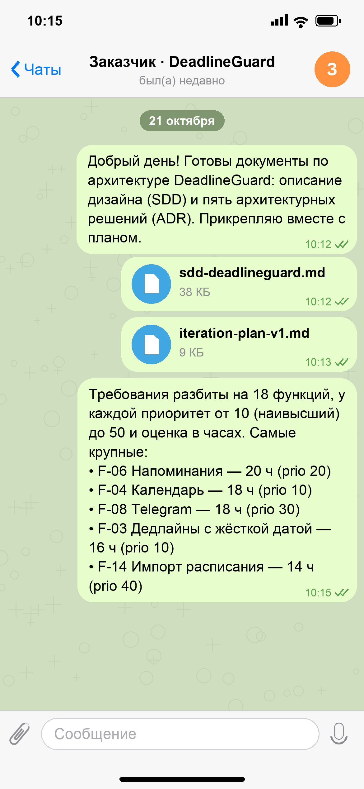

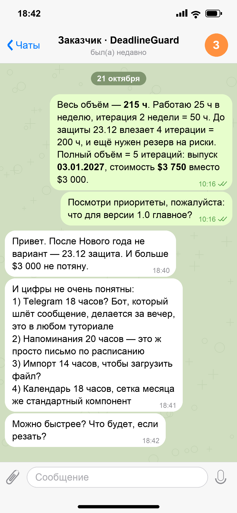

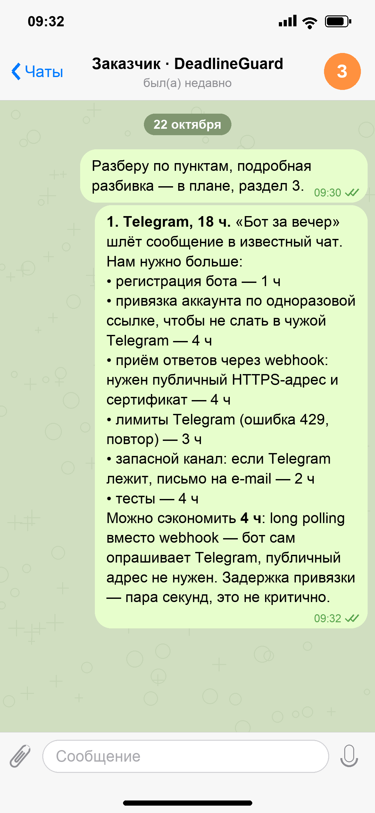

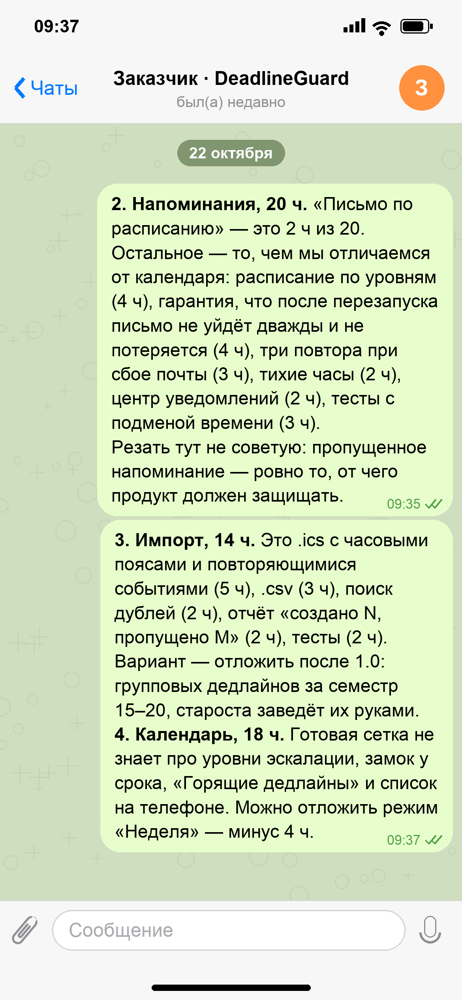

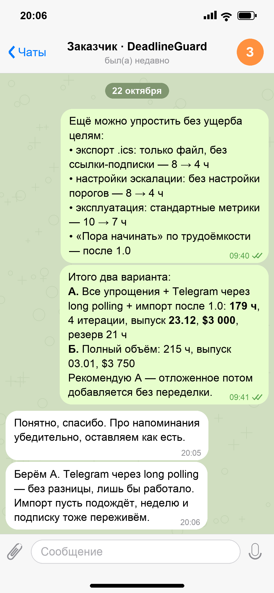

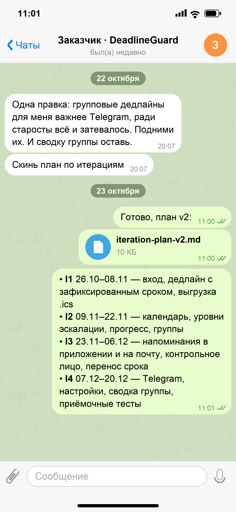

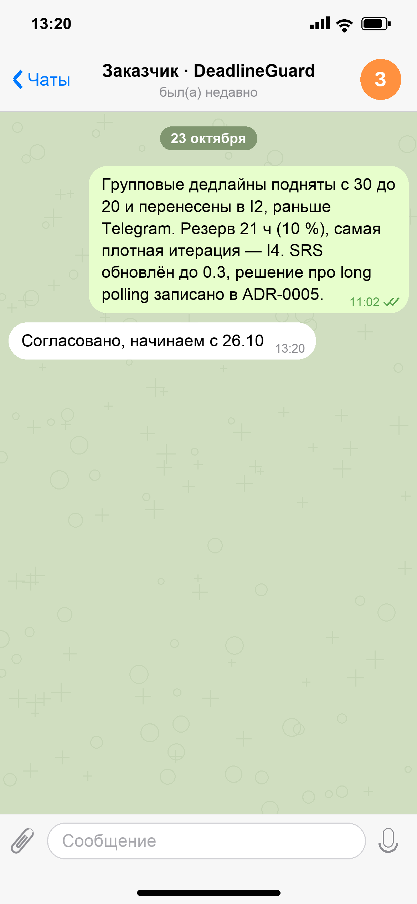

### Текст переписки

**21 октября**

*10:12* **Исполнитель:** Добрый день! Готовы документы по архитектуре DeadlineGuard: описание дизайна (SDD) и пять архитектурных решений (ADR). Прикрепляю вместе с планом.

*10:12* **Исполнитель:** 📎 `sdd-deadlineguard.md` (38 КБ)

*10:13* **Исполнитель:** 📎 `iteration-plan-v1.md` (9 КБ)

*10:15* **Исполнитель:** Требования разбиты на 18 функций, у каждой приоритет от 10 (наивысший) до 50 и оценка в часах. Самые крупные:  
• F-06 Напоминания — 20 ч (prio 20)  
• F-04 Календарь — 18 ч (prio 10)  
• F-08 Telegram — 18 ч (prio 30)  
• F-03 Дедлайны с жёсткой датой — 16 ч (prio 10)  
• F-14 Импорт расписания — 14 ч (prio 40)

*10:16* **Исполнитель:** Весь объём — **215 ч**. Работаю 25 ч в неделю, итерация 2 недели = 50 ч. До защиты 23.12 влезает 4 итерации = 200 ч, и ещё нужен резерв на риски.  
Полный объём = 5 итераций: выпуск **03.01.2027**, стоимость **$3 750** вместо $3 000.

*10:16* **Исполнитель:** Посмотри приоритеты, пожалуйста: что для версии 1.0 главное?

*18:40* **Заказчик:** Привет. После Нового года не вариант — 23.12 защита. И больше $3 000 не потяну.

*18:41* **Заказчик:** И цифры не очень понятны:  
1) Telegram 18 часов? Бот, который шлёт сообщение, делается за вечер, это в любом туториале  
2) Напоминания 20 часов — это ж просто письмо по расписанию  
3) Импорт 14 часов, чтобы загрузить файл?  
4) Календарь 18 часов, сетка месяца же стандартный компонент

*18:42* **Заказчик:** Можно быстрее? Что будет, если резать?

**22 октября**

*09:30* **Исполнитель:** Разберу по пунктам, подробная разбивка — в плане, раздел 3.

*09:32* **Исполнитель:** **1. Telegram, 18 ч.** «Бот за вечер» шлёт сообщение в известный чат. Нам нужно больше:  
• регистрация бота — 1 ч  
• привязка аккаунта по одноразовой ссылке, чтобы не слать в чужой Telegram — 4 ч  
• приём ответов через webhook: нужен публичный HTTPS-адрес и сертификат — 4 ч  
• лимиты Telegram (ошибка 429, повтор) — 3 ч  
• запасной канал: если Telegram лежит, письмо на e-mail — 2 ч  
• тесты — 4 ч  
Можно сэкономить **4 ч**: long polling вместо webhook — бот сам опрашивает Telegram, публичный адрес не нужен. Задержка привязки — пара секунд, это не критично.

*09:35* **Исполнитель:** **2. Напоминания, 20 ч.** «Письмо по расписанию» — это 2 ч из 20. Остальное — то, чем мы отличаемся от календаря: расписание по уровням (4 ч), гарантия, что после перезапуска письмо не уйдёт дважды и не потеряется (4 ч), три повтора при сбое почты (3 ч), тихие часы (2 ч), центр уведомлений (2 ч), тесты с подменой времени (3 ч).  
Резать тут не советую: пропущенное напоминание — ровно то, от чего продукт должен защищать.

*09:37* **Исполнитель:** **3. Импорт, 14 ч.** Это .ics с часовыми поясами и повторяющимися событиями (5 ч), .csv (3 ч), поиск дублей (2 ч), отчёт «создано N, пропущено M» (2 ч), тесты (2 ч). Вариант — отложить после 1.0: групповых дедлайнов за семестр 15–20, староста заведёт их руками.  
**4. Календарь, 18 ч.** Готовая сетка не знает про уровни эскалации, замок у срока, «Горящие дедлайны» и список на телефоне. Можно отложить режим «Неделя» — минус 4 ч.

*09:40* **Исполнитель:** Ещё можно упростить без ущерба целям:  
• экспорт .ics: только файл, без ссылки-подписки — 8 → 4 ч  
• настройки эскалации: без настройки порогов — 8 → 4 ч  
• эксплуатация: стандартные метрики — 10 → 7 ч  
• «Пора начинать» по трудоёмкости — после 1.0

*09:41* **Исполнитель:** Итого два варианта:  
**А.** Все упрощения + Telegram через long polling + импорт после 1.0: **179 ч**, 4 итерации, выпуск **23.12**, **$3 000**, резерв 21 ч  
**Б.** Полный объём: 215 ч, выпуск 03.01, $3 750  
Рекомендую А — отложенное потом добавляется без переделки.

*20:05* **Заказчик:** Понятно, спасибо. Про напоминания убедительно, оставляем как есть.

*20:06* **Заказчик:** Берём А. Telegram через long polling — без разницы, лишь бы работало. Импорт пусть подождёт, неделю и подписку тоже переживём.

*20:07* **Заказчик:** Одна правка: групповые дедлайны для меня важнее Telegram, ради старосты всё и затевалось. Подними их. И сводку группы оставь.

*20:07* **Заказчик:** Скинь план по итерациям

**23 октября**

*11:00* **Исполнитель:** Готово, план v2:

*11:00* **Исполнитель:** 📎 `iteration-plan-v2.md` (10 КБ)

*11:01* **Исполнитель:** • **I1** 26.10–08.11 — вход, дедлайн с зафиксированным сроком, выгрузка .ics  
• **I2** 09.11–22.11 — календарь, уровни эскалации, прогресс, группы  
• **I3** 23.11–06.12 — напоминания в приложении и на почту, контрольное лицо, перенос срока  
• **I4** 07.12–20.12 — Telegram, настройки, сводка группы, приёмочные тесты

*11:02* **Исполнитель:** Групповые дедлайны подняты с 30 до 20 и перенесены в I2, раньше Telegram. Резерв 21 ч (10 %), самая плотная итерация — I4. SRS обновлён до 0.3, решение про long polling записано в ADR-0005.

*13:20* **Заказчик:** Согласовано, начинаем с 26.10

---

## Раунд 2. Изменения объёма

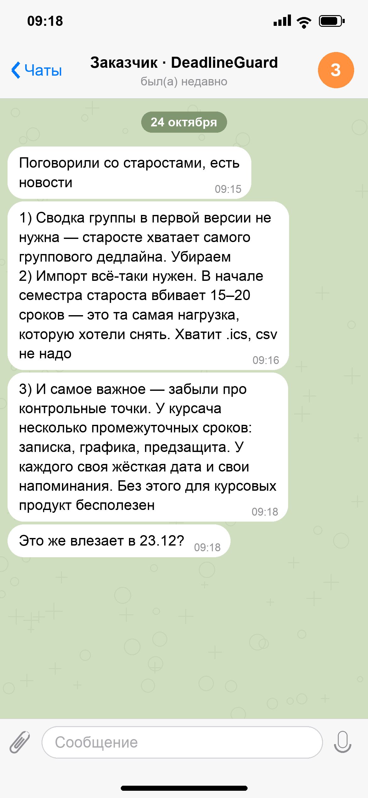

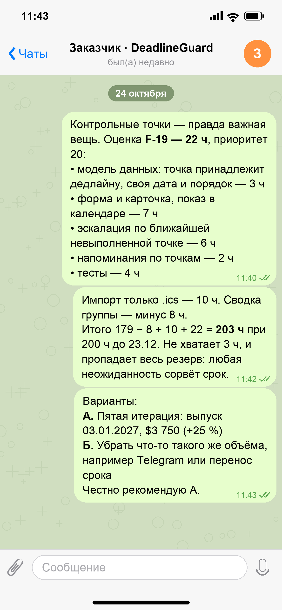

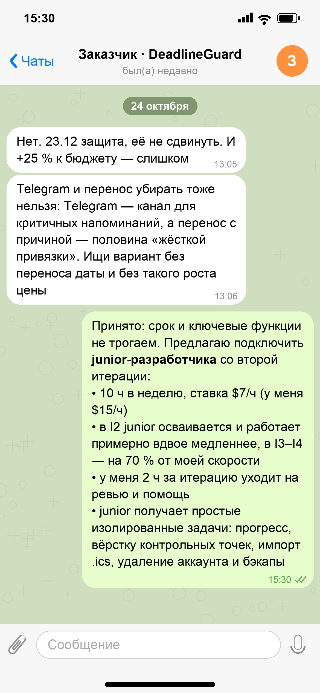

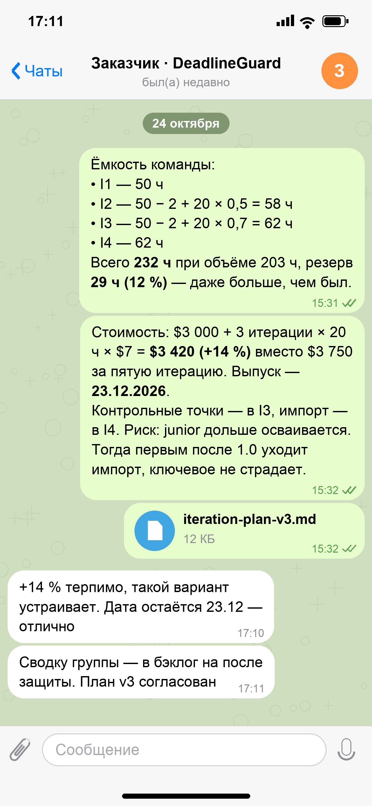

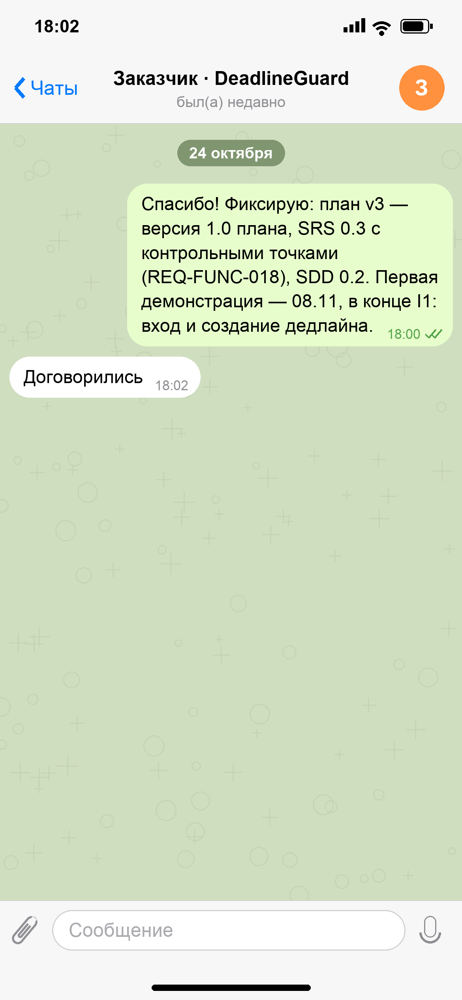

### Текст переписки

**24 октября**

*09:15* **Заказчик:** Поговорили со старостами, есть новости

*09:16* **Заказчик:** 1) Сводка группы в первой версии не нужна — старосте хватает самого группового дедлайна. Убираем  
2) Импорт всё-таки нужен. В начале семестра староста вбивает 15–20 сроков — это та самая нагрузка, которую хотели снять. Хватит .ics, csv не надо

*09:18* **Заказчик:** 3) И самое важное — забыли про контрольные точки. У курсача несколько промежуточных сроков: записка, графика, предзащита. У каждого своя жёсткая дата и свои напоминания. Без этого для курсовых продукт бесполезен

*09:18* **Заказчик:** Это же влезает в 23.12?

*11:40* **Исполнитель:** Контрольные точки — правда важная вещь. Оценка **F-19 — 22 ч**, приоритет 20:  
• модель данных: точка принадлежит дедлайну, своя дата и порядок — 3 ч  
• форма и карточка, показ в календаре — 7 ч  
• эскалация по ближайшей невыполненной точке — 6 ч  
• напоминания по точкам — 2 ч  
• тесты — 4 ч

*11:42* **Исполнитель:** Импорт только .ics — 10 ч. Сводка группы — минус 8 ч.  
Итого 179 − 8 + 10 + 22 = **203 ч** при 200 ч до 23.12. Не хватает 3 ч, и пропадает весь резерв: любая неожиданность сорвёт срок.

*11:43* **Исполнитель:** Варианты:  
**А.** Пятая итерация: выпуск 03.01.2027, $3 750 (+25 %)  
**Б.** Убрать что-то такого же объёма, например Telegram или перенос срока  
Честно рекомендую А.

*13:05* **Заказчик:** Нет. 23.12 защита, её не сдвинуть. И +25 % к бюджету — слишком

*13:06* **Заказчик:** Telegram и перенос убирать тоже нельзя: Telegram — канал для критичных напоминаний, а перенос с причиной — половина «жёсткой привязки». Ищи вариант без переноса даты и без такого роста цены

*15:30* **Исполнитель:** Принято: срок и ключевые функции не трогаем. Предлагаю подключить **junior-разработчика** со второй итерации:  
• 10 ч в неделю, ставка $7/ч (у меня $15/ч)  
• в I2 junior осваивается и работает примерно вдвое медленнее, в I3–I4 — на 70 % от моей скорости  
• у меня 2 ч за итерацию уходит на ревью и помощь  
• junior получает простые изолированные задачи: прогресс, вёрстку контрольных точек, импорт .ics, удаление аккаунта и бэкапы

*15:31* **Исполнитель:** Ёмкость команды:  
• I1 — 50 ч  
• I2 — 50 − 2 + 20 × 0,5 = 58 ч  
• I3 — 50 − 2 + 20 × 0,7 = 62 ч  
• I4 — 62 ч  
Всего **232 ч** при объёме 203 ч, резерв **29 ч (12 %)** — даже больше, чем был.

*15:32* **Исполнитель:** Стоимость: $3 000 + 3 итерации × 20 ч × $7 = **$3 420 (+14 %)** вместо $3 750 за пятую итерацию. Выпуск — **23.12.2026**.  
Контрольные точки — в I3, импорт — в I4. Риск: junior дольше осваивается. Тогда первым после 1.0 уходит импорт, ключевое не страдает.

*15:32* **Исполнитель:** 📎 `iteration-plan-v3.md` (12 КБ)

*17:10* **Заказчик:** +14 % терпимо, такой вариант устраивает. Дата остаётся 23.12 — отлично

*17:11* **Заказчик:** Сводку группы — в бэклог на после защиты. План v3 согласован

*18:00* **Исполнитель:** Спасибо! Фиксирую: план v3 — версия 1.0 плана, SRS 0.3 с контрольными точками (REQ-FUNC-018), SDD 0.2. Первая демонстрация — 08.11, в конце I1: вход и создание дедлайна.

*18:02* **Заказчик:** Договорились

---

## Итог переписки

| Версия плана | Объём | Итерации | Выпуск | Стоимость | Статус |
|--------------|-------|----------|--------|-----------|--------|
| v1 — разработанный | 215 ч | 5 | 03.01.2027 | $3 750 | отклонён: позже защиты, выше бюджета |
| v2 — изменённый | 179 ч | 4 | 23.12.2026 | $3 000 | согласован 23.10, изменён во втором раунде |
| v3 — согласованный | 203 ч | 4 (+ junior с I2) | 23.12.2026 | $3 420 | **согласован 24.10** |
