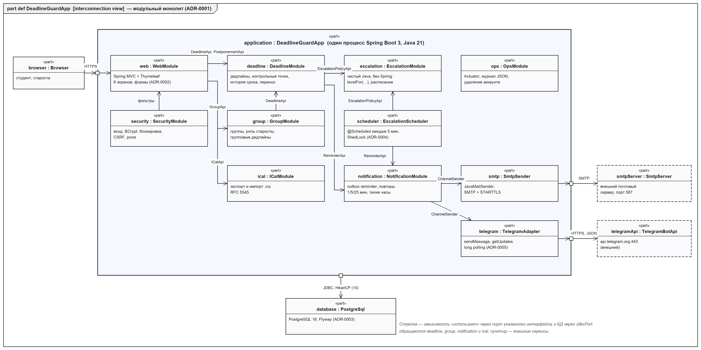
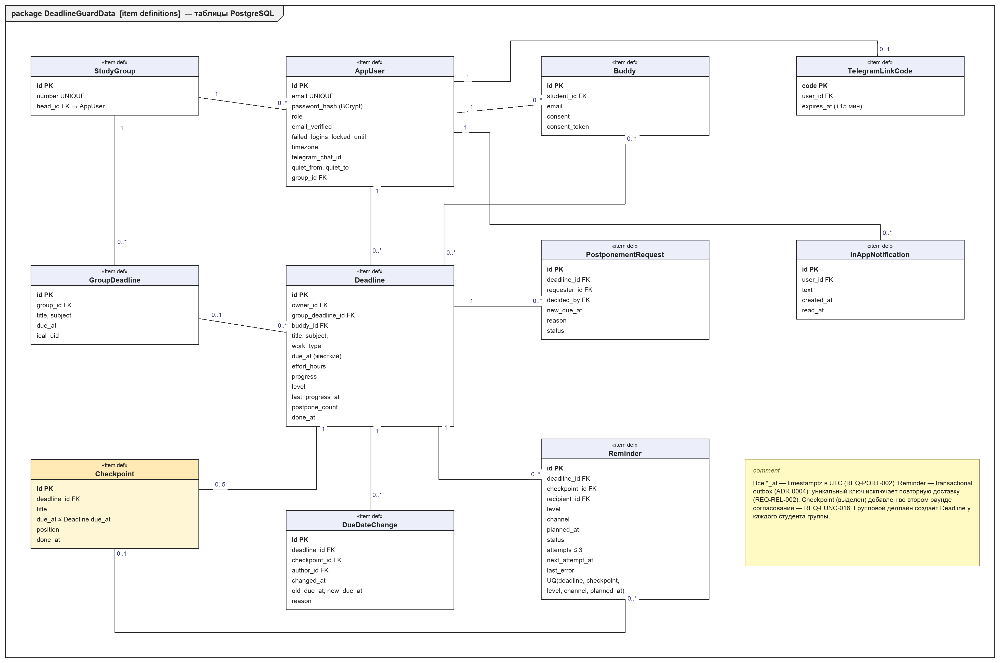
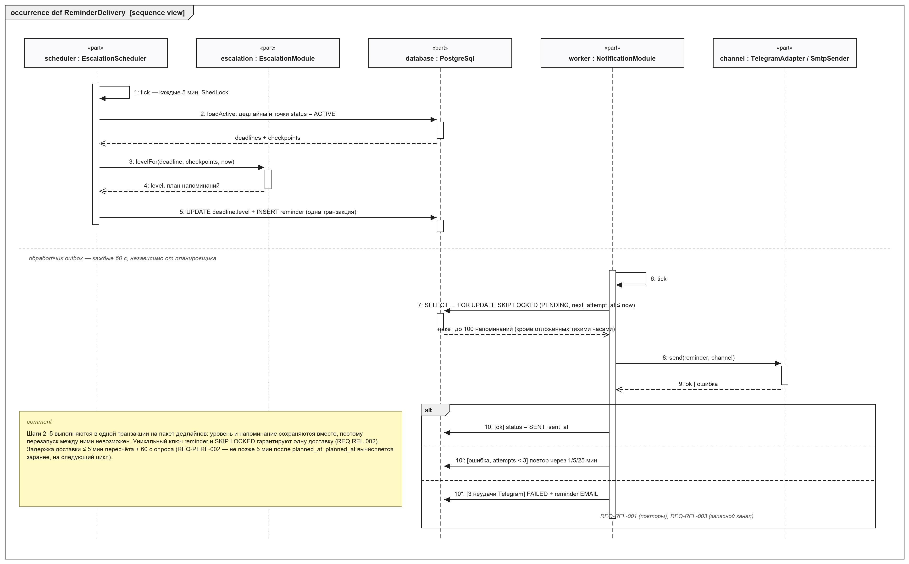
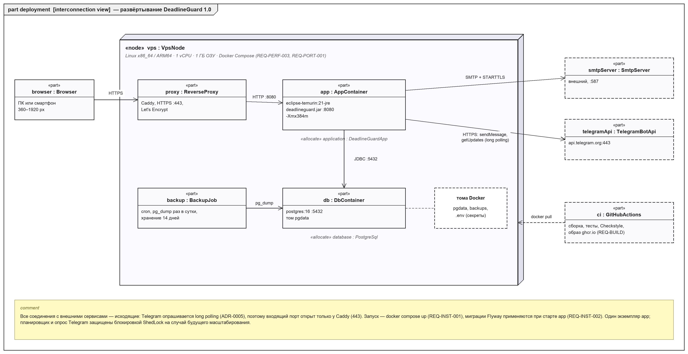

# Описание дизайна программного обеспечения

Для DeadlineGuard — веб-приложения «Трекер дедлайнов для студентов»

Версия 0.2

Подготовил Драко М. Д., гр. 450501

БГУИР, факультет КСиС, кафедра ЭВМ

24.10.2026

## Оглавление

<!-- TOC -->
* [1. Введение](#1-introduction)
  * [1.1 Назначение документа](#11-document-purpose)
  * [1.2 Область применения](#12-subject-scope)
  * [1.3 Определения, акронимы и сокращения](#13-definitions-acronyms-and-abbreviations)
  * [1.4 Ссылки](#14-references)
  * [1.5 Обзор документа](#15-document-overview)
* [2. Обзор дизайна](#2-design-overview)
  * [2.1 Задачи стейкхолдеров](#21-stakeholder-concerns)
  * [2.2 Выбранные точки зрения](#22-selected-viewpoints)
* [3. Проектные представления](#3-design-views)
* [4. Решения](#4-decisions)
* [5. Приложения](#5-appendixes)
<!-- TOC -->

## История изменений

| Name | Date | Reason For Changes | Version |
|------|------|--------------------|---------|
| Драко М. Д. | 21.10.2026 | Первая редакция по SRS 0.2: модули, данные, доставка напоминаний, развёртывание, ADR-0001…0004 | 0.1 |
| Драко М. Д. | 24.10.2026 | По итогам согласования плана: Telegram через long polling (ADR-0005), контрольные точки (REQ-FUNC-018) в модели данных и алгоритме эскалации, импорт только .ics, сводка группы исключена из 1.0 | 0.2 |

---

## 1. Введение {#1-introduction}

Документ описывает, **КАК** устроено веб-приложение DeadlineGuard 1.0, требования к которому зафиксированы в
[`../srs/srs-deadlineguard.md`](../srs/srs-deadlineguard.md) (версия 0.3). SRS отвечает на вопрос «что должна
делать система», SDD — «из чего она состоит и как работает», ADR — «почему выбрано именно так».

### 1.1 Назначение документа {#11-document-purpose}

SDD — руководство для команды разработки (middle- и junior-разработчик) при реализации версии 1.0 по плану
[`../plan/iteration-plan.md`](../plan/iteration-plan.md). Заказчик использует документ при согласовании сроков
(оценки функций опираются на описанные здесь элементы), преподаватель — при проверке, сопровождающий — при
эксплуатации (представления 009, 010). Значимые решения вынесены в `adr/`.

### 1.2 Область применения {#12-subject-scope}

Проектируется DeadlineGuard 1.0 целиком: веб-интерфейс, серверная логика, база данных, планировщик эскалации,
доставка уведомлений по e-mail и Telegram, импорт и экспорт iCalendar. Система реализует бизнес-цели BG-1…BG-4
(SRS, раздел 1.2): жёсткая привязка сроков, нарастающие напоминания, контрольное лицо, групповые дедлайны старосты.

**Не входит в версию 1.0** (SRS, приложение Г): сводка группы, импорт .csv, ссылка-подписка на календарь,
режим «Неделя», настройка порогов эскалации, предупреждение о трудоёмкости, интеграция с ИИС БГУИР, мобильные
приложения, SMS.

### 1.3 Определения, акронимы и сокращения {#13-definitions-acronyms-and-abbreviations}

| Term | Definition |
|------|------------|
| ADR | Architecture Decision Record — запись архитектурного решения (формат MADR) |
| API | Application Programming Interface — набор определений и протоколов для интеграции программ |
| CSRF | Cross-Site Request Forgery — подделка межсайтового запроса |
| Flyway | инструмент версионных миграций схемы БД |
| Long polling | приём обновлений Telegram запросом `getUpdates`, который ждёт новых событий до таймаута |
| Outbox (transactional outbox) | паттерн: сообщение сначала записывается в таблицу в той же транзакции, что и изменение данных, затем доставляется отдельным обработчиком |
| SDD | Software Design Description — описание дизайна ПО (IEEE 1016) |
| ShedLock | библиотека блокировки периодических задач через таблицу БД |
| SKIP LOCKED | режим `SELECT … FOR UPDATE`, пропускающий строки, заблокированные другой транзакцией |
| Контрольная точка | промежуточный срок большой работы со своей жёсткой датой (REQ-FUNC-018) |
| Модульный монолит | одно развёртываемое приложение, разделённое на модули с явными границами |

Термины предметной области (дедлайн, уровень эскалации, контрольное лицо, тихие часы) — в SRS, раздел 1.3.

### 1.4 Ссылки {#14-references}

| Документ | Версия / дата | Расположение | Статус |
|----------|---------------|--------------|--------|
| SRS DeadlineGuard | 0.3, 24.10.2026 | `srs/srs-deadlineguard.md` | нормативная |
| План реализации и переписка с Заказчиком | 1.0, 24.10.2026 | `plan/iteration-plan.md`, `plan/correspondence.md` | нормативная |
| ADR-0001…0005 | 2026-10 | `adr/` | нормативная |
| Шаблон SDD курса ЖЦРПО | 2026 | `sdd/sdd-template.md` | нормативная |
| IEEE 1016-2009 Software Design Descriptions | 2009 | ieee.org | справочная |
| ISO/IEC/IEEE 42010:2011 Architecture description | 2011 | iso.org | справочная |
| OMG SysML v2.0 | 2025 | omg.org/spec/SysML | справочная |
| Модели SysML v2 дизайна | 0.2 | `sdd/models/*.sysml` | справочная |

### 1.5 Обзор документа {#15-document-overview}

Раздел 2 перечисляет стейкхолдеров и выбранные точки зрения, раздел 3 — проектные представления с
идентификаторами `NNN-название` и ссылками на требования SRS и ADR, раздел 4 — краткое изложение решений (полные
записи — в `adr/`), раздел 5 — матрица трассировки «функция плана → представление → требование». Диаграммы
выполнены на SysML v2: тексты моделей — в `sdd/models`, изображения — в `sdd/images`. Изменения вносятся через
pull request и отражаются в «Истории изменений».

---

## 2. Обзор дизайна {#2-design-overview}

### 2.1 Задачи стейкхолдеров {#21-stakeholder-concerns}

| Стейкхолдер | Задачи (concerns) | Где адресуется |
|-------------|-------------------|----------------|
| Заказчик | срок 23.12.2026, бюджет, надёжность напоминаний, понятность оценок | 002, 005, 006; ADR-0001, ADR-0004, ADR-0005; план |
| Студент, староста | напоминания вовремя и без дублей, жёсткий срок, работа со смартфона | 004, 005, 006, 007 |
| Контрольное лицо | уведомление только с согласия и один раз | 003, 006 |
| Middle-разработчик | границы модулей, контракты, тестируемость правил эскалации | 002, 004, 006, 011; ADR-0001 |
| Junior-разработчик | изолированные задачи, понятные интерфейсы и данные | 002, 003, 004 |
| Оператор / сопровождающий | запуск одной командой, ресурсы 1 vCPU / 1 ГБ, резервные копии, журналы | 009, 010; ADR-0003 |
| Преподаватель | соответствие шаблонам и трассируемость к SRS | раздел 5 |

### 2.2 Выбранные точки зрения {#22-selected-viewpoints}

Язык представлений — SysML v2 (текстовая нотация в `sdd/models`, графическая — PNG), дополнительно таблицы и
псевдокод.

#### 2.2.1 Контекст {#221-context}

Используется: представление **001-context**. Система как «чёрный ящик», пользователи и внешние сервисы.

#### 2.2.2 Композиция {#222-composition}

Используется: **002-modules** — модули монолита и адаптеры внешних сервисов (SysML v2 interconnection view).

#### 2.2.3 Логическое представление {#223-logical}

Не выделяется отдельно: основные типы совпадают с сущностями представления 003 и портами модулей 002.
Классы уточняются в коде (доменные классы модулей `deadline` и `escalation`).

#### 2.2.4 Физическое представление {#224-physical}

Объединено с развёртыванием в **009-deployment**: одна виртуальная машина, отдельной аппаратной топологии нет.

#### 2.2.5 Структура {#225-structure}

Покрывается **002-modules**: порты (`DeadlineApi`, `ReminderApi`, `ChannelSender` и др.) и соединения между
модулями.

#### 2.2.6 Зависимости {#226-dependency}

Покрывается **002-modules** (направленные стрелки «использует») и правилом ADR-0001: модуль `escalation` не
зависит ни от кого, проверяется ArchUnit.

#### 2.2.7 Информация {#227-information}

Используется: **003-data-model** — таблицы PostgreSQL как `item def` SysML v2.

#### 2.2.8 Интерфейс {#228-interface}

Используется: **004-interface** — HTTP-маршруты веб-интерфейса и контракты с SMTP и Telegram Bot API.

#### 2.2.9 Взаимодействие {#229-interaction}

Используется: **005-reminder-delivery** — последовательность «пересчёт уровня → outbox → доставка» со «счастливым
путём» и путями отказа.

#### 2.2.10 Алгоритм {#2210-algorithm}

Используется: **006-escalation-algorithm** — расчёт уровня с учётом контрольных точек и планирование напоминаний.

#### 2.2.11 Динамика состояний {#2211-state-dynamics}

Используется: **007-deadline-states** — автомат `DeadlineState` из SRS (рисунок 10) и его применение к
контрольным точкам.

#### 2.2.12 Параллелизм {#2212-concurrency}

Используется: **008-concurrency** — планировщик, обработчик outbox, опрос Telegram и действия пользователя.

#### 2.2.13 Паттерны {#2213-patterns}

Используется: **011-patterns**.

#### 2.2.14 Развёртывание {#2214-deployment}

Используется: **009-deployment** — контейнеры на VPS и связи с внешними сервисами.

#### 2.2.15 Ресурсы {#2215-resources}

Используется: **010-resources** — распределение памяти, соединений и потоков в пределах 1 vCPU / 1 ГБ.

---

## 3. Проектные представления {#3-design-views}

### 001-context

- **ID:** 001-context
- **Title:** Контекст системы
- **Viewpoint:** Context
- **Representation:** контекстная диаграмма SRS — [`../srs/images/context.png`](../srs/images/context.png),
  модель [`../srs/models/context.sysml`](../srs/models/context.sysml). Пользователи (студент, староста, контрольное
  лицо) работают через браузер по HTTPS; система обращается к SMTP-серверу, Telegram Bot API и обменивается
  файлами .ics с внешними календарями. Все соединения с внешними сервисами — исходящие (ADR-0005).
- **More Information:** варианты использования — [`../srs/images/use-cases.png`](../srs/images/use-cases.png).

### 002-modules

- **ID:** 002-modules
- **Title:** Модули модульного монолита и их интерфейсы
- **Viewpoint:** Composition, Structure, Dependency
- **Representation:** 

  *Рисунок 1 — `part def DeadlineGuardApp`. Модель: [`models/architecture.sysml`](models/architecture.sysml)*

  | Модуль | Ответственность | Требования |
  |--------|-----------------|------------|
  | `web` | контроллеры Spring MVC и шаблоны Thymeleaf шести экранов, валидация форм, сообщения об ошибках у поля | REQ-INT-001…004, REQ-FUNC-002/003 |
  | `security` | регистрация, подтверждение e-mail, вход, BCrypt, блокировка после 5 попыток, CSRF, роли | REQ-FUNC-001, REQ-SEC-001…003 |
  | `deadline` | дедлайны, контрольные точки, история срока, запрет прямой смены срока, перенос, прогресс | REQ-FUNC-002/004/007…009/018 |
  | `group` | группы, роль старосты, групповые дедлайны | REQ-FUNC-011, REQ-SEC-003 |
  | `escalation` | чистый Java: `levelFor(...)`, расписание напоминаний по уровням, тихие часы | REQ-FUNC-005/006/015, REQ-MAINT-001 |
  | `scheduler` | периодический пересчёт уровней (5 мин) под блокировкой ShedLock | REQ-FUNC-005 |
  | `notification` | outbox `reminder`, обработчик (60 с), повторы, запасной канал, центр уведомлений | REQ-FUNC-006/016, REQ-REL-001…003 |
  | `ical` | экспорт .ics, импорт .ics (RFC 5545) с поиском дублей по UID | REQ-FUNC-012/013, REQ-COMP-002 |
  | `ops` | Actuator-метрики, журнал JSON с маскированием, удаление аккаунта | REQ-SEC-005, REQ-OBS-001/002 |
  | `smtp`, `telegram` | адаптеры каналов за общим интерфейсом `ChannelSender` | REQ-INT-005, REQ-REL-003 |

  Правила зависимостей: модуль обращается к другому только через его интерфейс (порт); `escalation` ни от кого
  не зависит; адаптеры внешних сервисов вызываются только из `notification`.
- **More Information:** ADR-0001, ADR-0002. Функции плана F-01…F-19 распределены по модулям в разделе 5.

### 003-data-model

- **ID:** 003-data-model
- **Title:** Модель данных
- **Viewpoint:** Information
- **Representation:** 

  *Рисунок 2 — `package DeadlineGuardData`. Модель: [`models/data-model.sysml`](models/data-model.sysml)*

  Ключевые правила целостности:
  - `deadline.due_at` и `checkpoint.due_at` меняются только транзакцией, которая одновременно пишет строку в
    `due_date_change` (REQ-FUNC-004); прямое изменение срока через API отклоняется с HTTP 409;
  - `checkpoint.due_at ≤ deadline.due_at`, не более 5 точек на дедлайн (CHECK и проверка в сервисе, REQ-FUNC-018);
  - групповой дедлайн (`group_deadline`) создаёт строку `deadline` у каждого студента группы; изменить срок
    может только староста (REQ-FUNC-011);
  - уникальный ключ `reminder (deadline_id, checkpoint_id, level, channel, planned_at)` исключает дубли
    (REQ-REL-002);
  - все поля `*_at` — `timestamptz` в UTC (REQ-PORT-002); схема ведётся миграциями Flyway `V1__…` (REQ-INST-002).
- **More Information:** ADR-0003, ADR-0004. Таблица `checkpoint` добавлена в версии 0.2 по итогам второго
  раунда согласования.

### 004-interface

- **ID:** 004-interface
- **Title:** HTTP-маршруты и контракты с внешними сервисами
- **Viewpoint:** Interface
- **Representation:**

  | Метод и маршрут | Экран / назначение | Ответ и ошибки | Требования |
  |-----------------|--------------------|----------------|------------|
  | `GET /login`, `POST /login` | вход | 302 на `/calendar`; «Неверный e-mail или пароль»; блокировка на 15 мин | REQ-FUNC-001, REQ-SEC-002 |
  | `GET /calendar?month=2026-10` | календарь и «Горящие дедлайны» | HTML; на ширине < 600 px — список | REQ-FUNC-003, REQ-INT-001 |
  | `POST /deadlines` | создание дедлайна и контрольных точек | 302; 422 с ошибкой у поля | REQ-FUNC-002/018 |
  | `GET /deadlines/{id}` | карточка | 403 для чужого дедлайна | REQ-FUNC-003, REQ-SEC-003 |
  | `PUT /deadlines/{id}` | изменение названия, предмета, каналов | **409**, если в теле изменён `dueAt` | REQ-FUNC-004 |
  | `POST /deadlines/{id}/progress` | отметка прогресса, «Сдано», отмена за 24 ч | 302 | REQ-FUNC-008 |
  | `POST /deadlines/{id}/checkpoints/{cid}/done` | отметка контрольной точки | 302; уровень пересчитывается сразу | REQ-FUNC-018 |
  | `POST /deadlines/{id}/postponements` | запрос переноса с причиной | 422 без причины или на третий перенос | REQ-FUNC-009 |
  | `POST /group/postponements/{rid}/decision` | решение старосты | 403 не старосте | REQ-FUNC-009 |
  | `POST /group/deadlines`, `POST /group/import` | групповой дедлайн, импорт .ics до 1 МБ | отчёт «создано N, пропущено M» | REQ-FUNC-011/012 |
  | `GET /export.ics` | выгрузка невыполненных дедлайнов | `text/calendar` | REQ-FUNC-013 |
  | `GET/POST /settings/escalation` | каналы, тихие часы, контрольное лицо, привязка Telegram | 302 | REQ-FUNC-010/015, REQ-INT-005 |
  | `GET /buddy/consent/{token}` | согласие или отказ контрольного лица | HTML | REQ-SEC-004 |

  Все изменяющие запросы требуют CSRF-токен (REQ-SEC-003). Внешние контракты: SMTP + STARTTLS :587, таймаут
  10 с; Telegram Bot API — `sendMessage` (таймаут 5 с, при HTTP 429 ожидание `retry_after`) и `getUpdates` с
  таймаутом 30 с (long polling, ADR-0005).
- **More Information:** макеты экранов — SRS, раздел 3.1.1; ADR-0002, ADR-0005.

### 005-reminder-delivery

- **ID:** 005-reminder-delivery
- **Title:** Пересчёт уровня и доставка напоминания
- **Viewpoint:** Interaction
- **Representation:** 

  *Рисунок 3 — `occurrence def ReminderDelivery`. Модель:
  [`models/reminder-delivery.sysml`](models/reminder-delivery.sysml)*

  Шаги 1–5 — планировщик раз в 5 минут; шаги 6–10 — обработчик outbox раз в 60 секунд. Пути отказа: временная
  ошибка канала — повтор через 1, 5 и 25 минут; три неудачи Telegram для уровня «Критично» — напоминание
  переставляется в канал e-mail; отсутствие согласия контрольного лица — напоминание получает статус SKIPPED,
  студенту показывается предупреждение.
- **More Information:** REQ-FUNC-006/007, REQ-REL-001…003, REQ-PERF-002; ADR-0004.

### 006-escalation-algorithm

- **ID:** 006-escalation-algorithm
- **Title:** Расчёт уровня эскалации с контрольными точками
- **Viewpoint:** Algorithm
- **Representation:** владелец — `escalation.EscalationPolicy` (чистая функция, время передаётся через
  `java.time.Clock` для тестов).

  ```text
  levelFor(deadline, checkpoints, now):
      if deadline.doneAt != null:                return DONE
      target ← первая по due_at точка с doneAt = null, иначе сам deadline      // REQ-FUNC-018
      hoursLeft ← (target.dueAt − now) в часах
      if hoursLeft ≤ 0:                          return OVERDUE (для target)
      level ← NORMAL
      if hoursLeft ≤ 168: level ← ATTENTION
      if hoursLeft ≤ 72:  level ← URGENT
      if hoursLeft ≤ 24:  level ← CRITICAL
      if level = CRITICAL and (now − deadline.lastProgressAt) ≥ 12 ч
         and buddy.consent = GRANTED and эскалация по target ещё не отправлялась:
                                                 level ← ESCALATED              // REQ-FUNC-007
      return level

  planReminders(deadline, level, now):
      для каждого канала уровня (REQ-FUNC-006), включённого пользователем:
          planned ← ближайшее время по расписанию уровня (09:00 / 09:00 и 18:00 / каждые 4 ч)
          если planned попадает в тихие часы и level ≠ CRITICAL: planned ← конец тихих часов   // REQ-FUNC-015
          INSERT reminder … ON CONFLICT DO NOTHING                                              // REQ-REL-002
      при смене уровня — дополнительное напоминание сразу (planned = now)
  ```

  Сложность — O(N + K) на цикл (N дедлайнов, K точек), обработка пакетами по 500 строк: 10 000 дедлайнов
  укладываются в цикл за секунды (REQ-PERF-002). Граничные значения 168/72/24/0 ч и 12 ч покрываются
  параметризованными тестами (EscalationLevelTest).
- **More Information:** REQ-FUNC-005…007/015/018; пороги — значения по умолчанию, их настройка отложена (SRS,
  приложение Г).

### 007-deadline-states

- **ID:** 007-deadline-states
- **Title:** Жизненный цикл дедлайна и контрольной точки
- **Viewpoint:** State Dynamics
- **Representation:** автомат `state def DeadlineState` — SRS, рисунок 10
  ([`../srs/images/escalation-states.png`](../srs/images/escalation-states.png)). В версии 1.0 тот же автомат
  применяется к цели `target` из представления 006: пока есть невыполненная контрольная точка, состояние `active`
  отражает её срок; отметка точки (`POST …/checkpoints/{cid}/done`) пересчитывает уровень по следующей точке или по
  сроку дедлайна. Просроченная точка переводит в `overdue` только её напоминания: дедлайн остаётся активным до
  своего срока. Состояние хранится в `deadline.level` и обновляется планировщиком и действиями пользователя.
- **More Information:** модель [`../srs/models/escalation.sysml`](../srs/models/escalation.sysml); REQ-FUNC-005,
  REQ-FUNC-018.

### 008-concurrency

- **ID:** 008-concurrency
- **Title:** Параллельные процессы и синхронизация
- **Viewpoint:** Concurrency
- **Representation:**

  | Процесс | Потоки | Синхронизация |
  |---------|--------|---------------|
  | HTTP-запросы | пул Tomcat, до 50 потоков | оптимистическая блокировка `@Version` у `deadline`: одновременные отметка прогресса и пересчёт уровня не теряют изменения |
  | Пересчёт уровней | 1 поток, раз в 5 мин | ShedLock (`lock_until`), чтобы при втором экземпляре задача не выполнялась дважды |
  | Обработчик outbox | 1 поток, раз в 60 с, пакет до 100 | `SELECT … FOR UPDATE SKIP LOCKED` и уникальный ключ `reminder` |
  | Опрос Telegram | 1 поток, `getUpdates` с таймаутом 30 с | ShedLock: опрашивает только один экземпляр (ADR-0005) |
  | Резервная копия | cron вне JVM, 03:00 | `pg_dump` с согласованным снимком, не блокирует запись |

  Порядок: напоминание создаётся только после фиксации транзакции со сменой уровня, поэтому обработчик никогда
  не видит «полузаписанное» состояние.
- **More Information:** REQ-REL-002, раздел 3.5.3 SRS; ADR-0004, ADR-0005.

### 009-deployment

- **ID:** 009-deployment
- **Title:** Развёртывание
- **Viewpoint:** Deployment, Physical
- **Representation:** 

  *Рисунок 4 — `part deployment`. Модель: [`models/architecture.sysml`](models/architecture.sysml)*

  Docker Compose на одной VPS: `proxy` (Caddy, HTTPS :443, Let's Encrypt), `app` (eclipse-temurin:21-jre,
  `deadlineguard.jar`), `db` (postgres:16, том `pgdata`), `backup` (cron + `pg_dump`). Секреты — в `.env`
  (пример — `.env.example`, REQ-INST-001). Образ собирается GitHub Actions и публикуется в ghcr.io
  (REQ-BUILD-001/002). Окружения: локальное (docker compose + MailHog), учебный сервер (OQ-1).
- **More Information:** REQ-INST-001/002, REQ-PORT-001, REQ-AVAIL-002, REQ-SEC-001; ADR-0001, ADR-0003, ADR-0005.

### 010-resources

- **ID:** 010-resources
- **Title:** Ресурсы сервера 1 vCPU / 1 ГБ
- **Viewpoint:** Resources
- **Representation:**

  | Ресурс | Распределение | Обоснование |
  |--------|---------------|-------------|
  | Память app | `-Xmx384m`, итог процесса ≈ 450 МБ | REQ-PERF-003 |
  | Память db | `shared_buffers = 128MB`, итог ≈ 200 МБ | данные 1.0 — десятки МБ |
  | Caddy и ОС | ≈ 30 МБ + ≈ 200 МБ | — |
  | Соединения с БД | HikariCP 10 | 50 HTTP-потоков, запросы короткие |
  | Пакеты | пересчёт — 500 строк, outbox — 100 строк | ограничение пиковой памяти |
  | Журналы | JSON, ротация, 30 дней | REQ-OBS-001 |

  Суммарно ≈ 880 МБ из 1 ГБ; при превышении первым уменьшается `-Xmx` до 320 МБ.
- **More Information:** REQ-PERF-001…003; проверяется нагрузочным тестом F-18 (200 пользователей, 10 000 дедлайнов).

### 011-patterns

- **ID:** 011-patterns
- **Title:** Применённые паттерны
- **Viewpoint:** Patterns
- **Representation:**

  | Паттерн | Где | Зачем |
  |---------|-----|-------|
  | Модульный монолит | всё приложение | границы модулей без накладных расходов микросервисов (ADR-0001) |
  | MVC (Spring MVC + Thymeleaf) | `web` | серверный рендеринг (ADR-0002) |
  | Transactional outbox | `notification` | одна доставка, повторы (ADR-0004) |
  | Strategy (`ChannelSender`) | `notification` → `smtp`, `telegram` | единая логика повторов для всех каналов, запасной канал |
  | Ports and Adapters | `smtp`, `telegram`, `ical` | внешние сервисы подменяются заглушками в тестах |
  | Чистая функция + внедрение `Clock` | `escalation` | детерминированные тесты границ уровней |
- **More Information:** REQ-MAINT-001, раздел 3.5.5 SRS (модуль эскалации как независимая библиотека).

---

## 4. Решения {#4-decisions}

Полные записи — в каталоге [`../adr`](../adr) (формат MADR).

- **ID:** 0001-modular-monolith-spring-boot
- **Title:** Модульный монолит на Spring Boot вместо микросервисов
- **Context:** 1–2 разработчика, сервер 1 vCPU / 1 ГБ, запуск одной командой, изоляция правил эскалации.
- **Options:** модульный монолит; микросервисы; слоистый монолит без модулей.
- **Outcome:** «модульный монолит», потому что только он укладывается в ресурсы и срок и сохраняет границы модулей.
- **More Information:** [`../adr/0001-modular-monolith-spring-boot.md`](../adr/0001-modular-monolith-spring-boot.md); 002, 009.

- **ID:** 0002-server-side-rendering-thymeleaf
- **Title:** Серверный рендеринг на Thymeleaf вместо SPA
- **Context:** CON-2 (минимум JavaScript), Java-команда без фронтенд-разработчика.
- **Options:** Thymeleaf + Spring MVC; React SPA + REST; Vaadin.
- **Outcome:** «Thymeleaf + Spring MVC», потому что соответствует CON-2 и даёт встроенную защиту CSRF.
- **More Information:** [`../adr/0002-server-side-rendering-thymeleaf.md`](../adr/0002-server-side-rendering-thymeleaf.md); 004.

- **ID:** 0003-postgresql-primary-db
- **Title:** PostgreSQL 16 с миграциями Flyway
- **Context:** транзакции «дедлайн + напоминание», очередь с `SKIP LOCKED`, время в UTC.
- **Options:** PostgreSQL 16; MySQL 8; MongoDB.
- **Outcome:** «PostgreSQL 16 + Flyway», потому что соответствует CON-3 и даёт `SKIP LOCKED` и `timestamptz`.
- **More Information:** [`../adr/0003-postgresql-primary-db.md`](../adr/0003-postgresql-primary-db.md); 003.

- **ID:** 0004-scheduler-with-transactional-outbox
- **Title:** Планировщик эскалации с transactional outbox
- **Context:** напоминания без потерь и дублей, повторы, точность ≤ 5 минут.
- **Options:** `@Scheduled` + ShedLock + outbox; прямая отправка; Quartz; RabbitMQ.
- **Outcome:** «`@Scheduled` + ShedLock + outbox», потому что закрывает REQ-REL-001/002 без брокера.
- **More Information:** [`../adr/0004-scheduler-with-transactional-outbox.md`](../adr/0004-scheduler-with-transactional-outbox.md); 005, 006, 008.

- **ID:** 0005-telegram-long-polling
- **Title:** Приём обновлений Telegram через long polling
- **Context:** сокращение трудоёмкости по просьбе Заказчика (раунд 1), хостинг не выбран.
- **Options:** long polling; webhook.
- **Outcome:** «long polling», потому что экономит 4 ч и не требует публичного адреса.
- **More Information:** [`../adr/0005-telegram-long-polling.md`](../adr/0005-telegram-long-polling.md); 004, 009.

---

## 5. Приложения {#5-appendixes}

**Приложение А. Трассировка «функция плана → представление → требования»**

| Функция | Priority | Итерация | Модули / представления | Требования SRS |
|---------|----------|----------|------------------------|----------------|
| F-01 Project skeleton & CI | 10 | I1 | 009, 011 | REQ-INST-001/002, REQ-BUILD-001/002 |
| F-02 Accounts & authentication | 10 | I1 | `security`; 004 | REQ-FUNC-001, REQ-SEC-001/002 |
| F-03 Deadlines with hard date binding | 10 | I1 | `deadline`; 003, 004 | REQ-FUNC-002/004 |
| F-15 Calendar export | 40 | I1 | `ical`; 004 | REQ-FUNC-013 |
| F-04 Calendar & hot list | 10 | I2 | `web`; 004 | REQ-FUNC-003, REQ-INT-001…004 |
| F-05 Escalation engine | 10 | I2 | `escalation`, `scheduler`; 006, 007 | REQ-FUNC-005 |
| F-07 Progress & completion | 10 | I2 | `deadline`; 004 | REQ-FUNC-008 |
| F-12 Groups & group deadlines | 20 | I2 | `group`; 003 | REQ-FUNC-011, REQ-SEC-003 |
| F-10 Postponement requests | 20 | I2 | `deadline`, `group`; 004 | REQ-FUNC-009 |
| F-06 Reminders: in-app & e-mail | 20 | I3 | `notification`, `smtp`; 005, 008 | REQ-FUNC-006/015/016, REQ-REL-001/002 |
| F-09 Buddy escalation | 20 | I3 | `deadline`, `notification`; 006 | REQ-FUNC-007, REQ-SEC-004 |
| F-19 Checkpoints for large assignments | 20 | I3 | `deadline`, `escalation`; 003, 006, 007 | REQ-FUNC-018 |
| F-08 Telegram channel | 30 | I4 | `telegram`; 004, 008 | REQ-INT-005, REQ-REL-003 |
| F-11 Escalation settings | 30 | I4 | `web`, `notification` | REQ-FUNC-010 |
| F-14 Schedule import (.ics) | 30 | I4 | `ical`, `group`; 004 | REQ-FUNC-012 |
| F-17 Operations | 30 | I4 | `ops`; 009, 010 | REQ-SEC-005, REQ-OBS-001/002, REQ-AVAIL-002 |
| F-18 Acceptance & load testing | 10 | I4 | 010 | REQ-PERF-001…003, REQ-MAINT-002 |

**Приложение Б. Модели SysML v2 и изображения**

| Файл | Содержание |
|------|------------|
| [models/architecture.sysml](models/architecture.sysml) | модули, порты, соединения, узлы развёртывания и `allocate` |
| [models/data-model.sysml](models/data-model.sysml) | `item def` таблиц, перечисления уровней, каналов и статусов |
| [models/reminder-delivery.sysml](models/reminder-delivery.sysml) | `occurrence def ReminderDelivery`: участники, сообщения, порядок |
| [images/components.png](images/components.png) | рисунок 1 — модули |
| [images/data-model.png](images/data-model.png) | рисунок 2 — модель данных |
| [images/reminder-delivery.png](images/reminder-delivery.png) | рисунок 3 — доставка напоминания |
| [images/deployment.png](images/deployment.png) | рисунок 4 — развёртывание |
