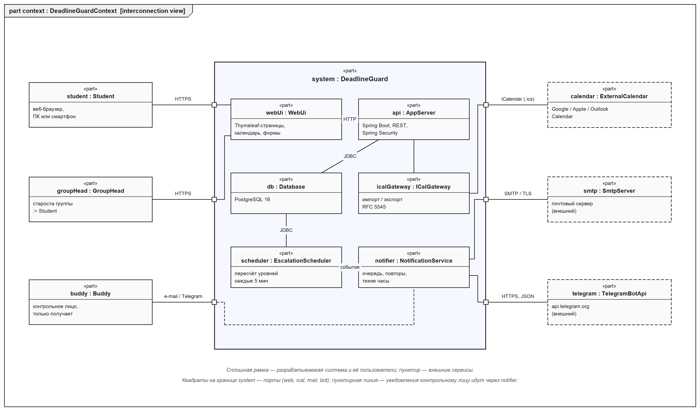
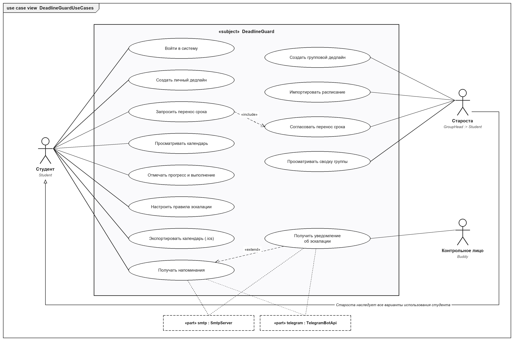
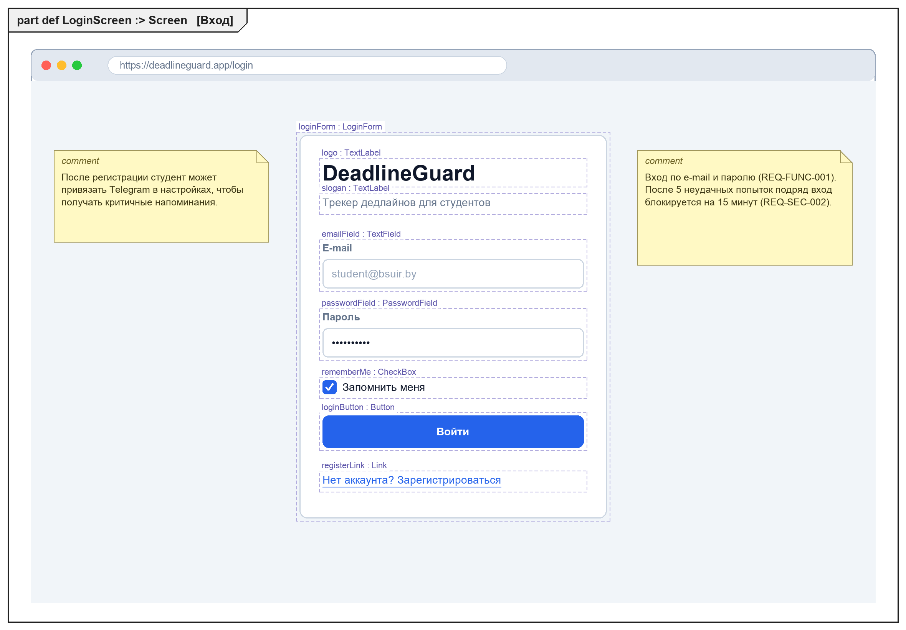
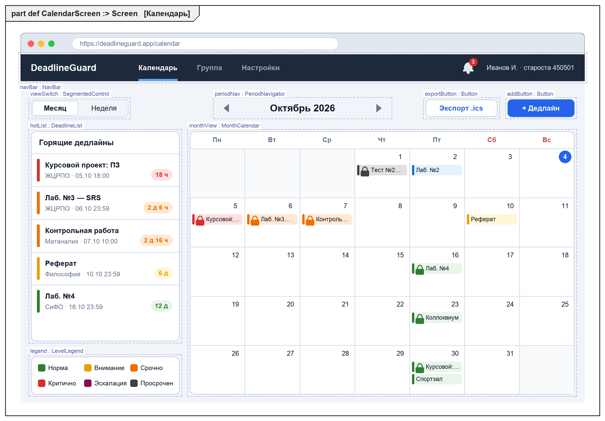
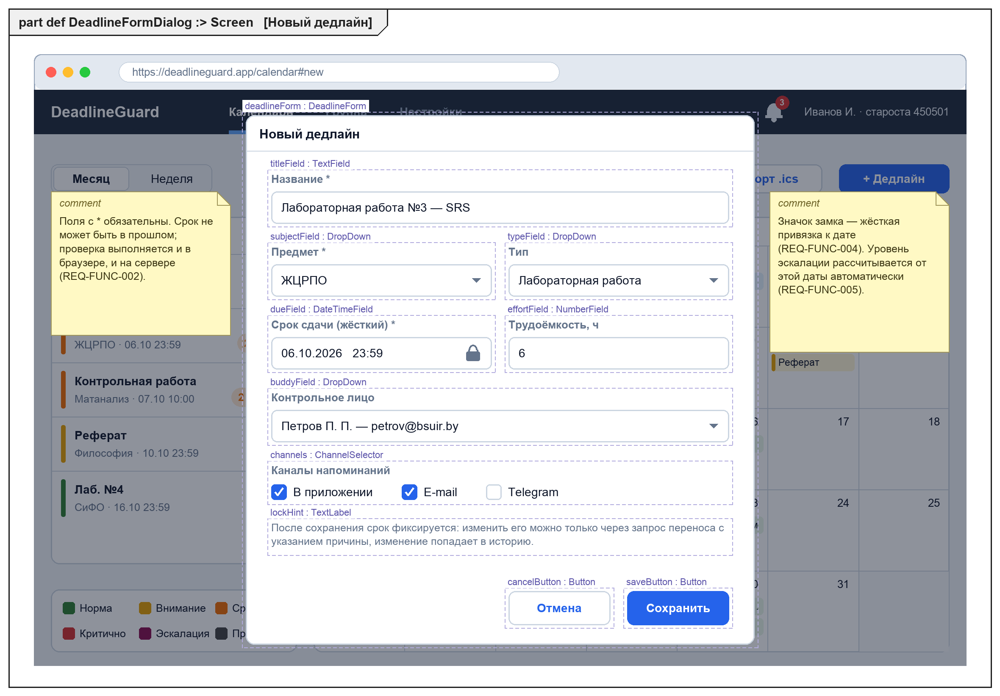
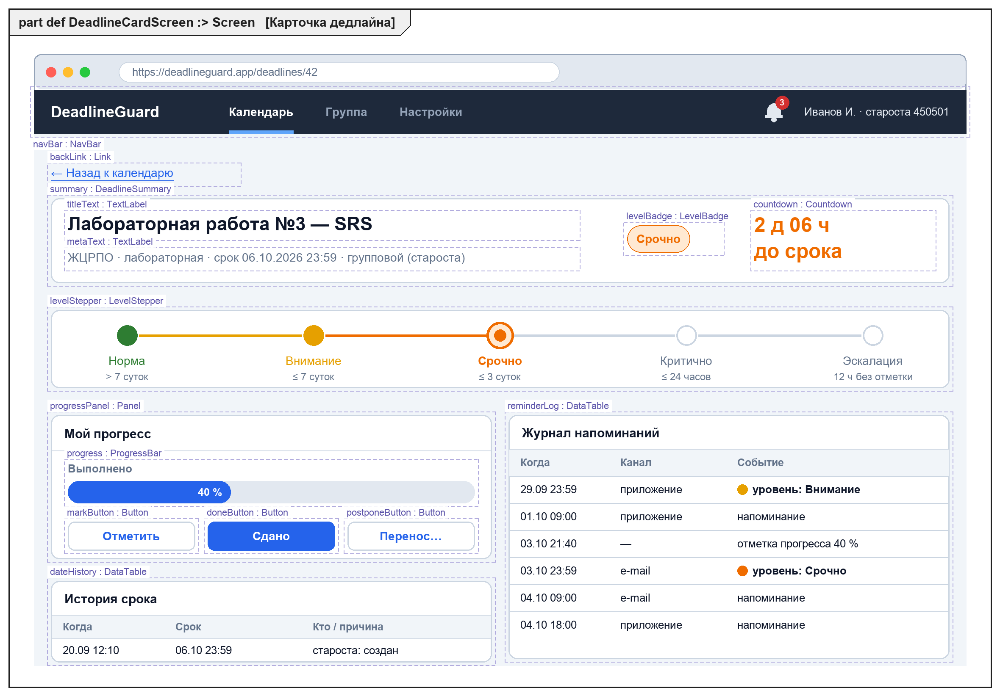
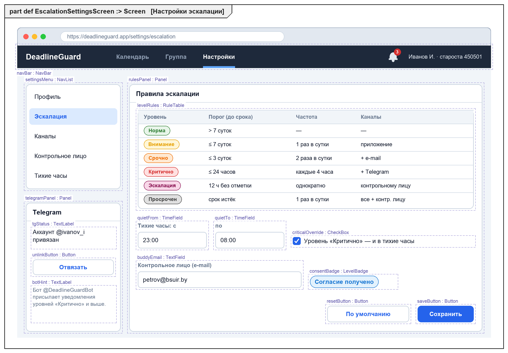
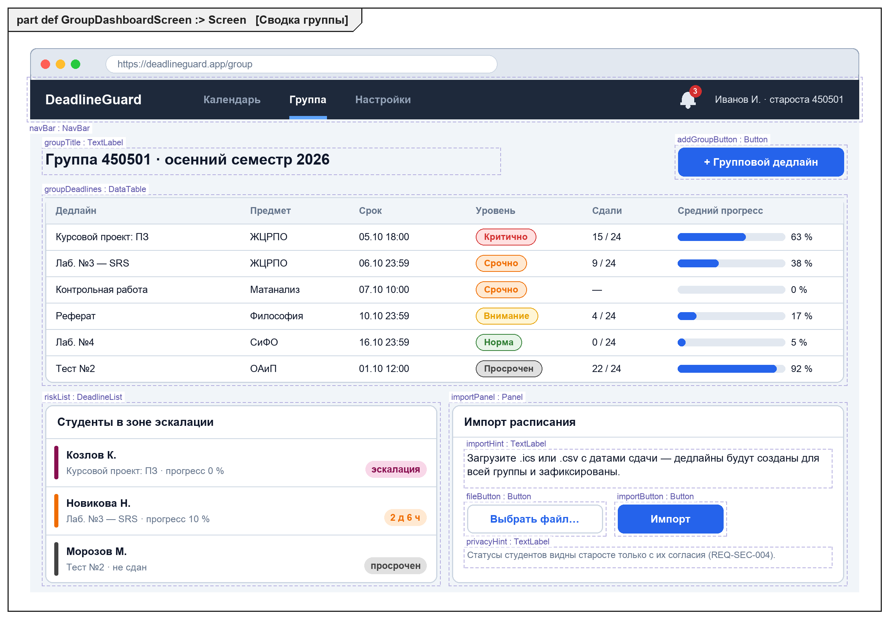
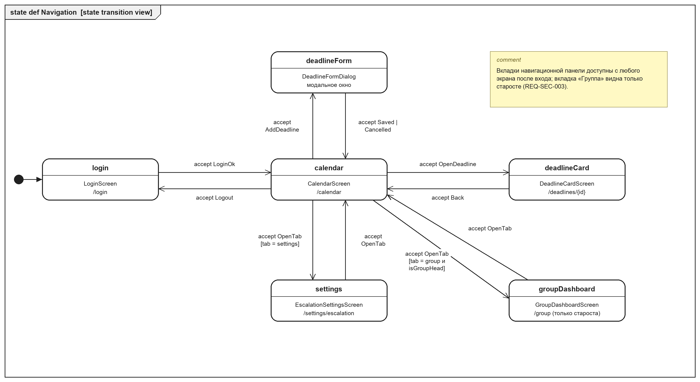
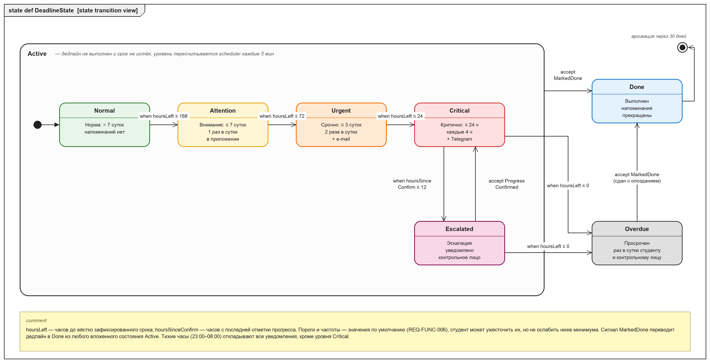

# Спецификация требований к ПО

Для DeadlineGuard — веб-приложения «Трекер дедлайнов для студентов»

Версия 0.3

Подготовил Драко М. Д., гр. 450501

БГУИР, факультет КСиС, кафедра ЭВМ

24.10.2026

## Оглавление

<!-- TOC -->
* [1. Введение](#1-introduction)
  * [1.1 Назначение документа](#11-document-purpose)
  * [1.2 Область применения продукта](#12-product-scope)
  * [1.3 Определения, акронимы и сокращения](#13-definitions-acronyms-and-abbreviations)
  * [1.4 Ссылки](#14-references)
  * [1.5 Обзор документа](#15-document-overview)
* [2. Обзор продукта](#2-product-overview)
  * [2.1 Перспектива продукта](#21-product-perspective)
  * [2.2 Функции продукта](#22-product-functions)
  * [2.3 Ограничения продукта](#23-product-constraints)
  * [2.4 Характеристики пользователей](#24-user-characteristics)
  * [2.5 Допущения и зависимости](#25-assumptions-and-dependencies)
  * [2.6 Распределение требований](#26-apportioning-of-requirements)
* [3. Требования](#3-requirements)
  * [3.1 Внешние интерфейсы](#31-external-interfaces)
    * [3.1.1 Пользовательские интерфейсы](#311-user-interfaces)
    * [3.1.2 Аппаратные интерфейсы](#312-hardware-interfaces)
    * [3.1.3 Программные интерфейсы](#313-software-interfaces)
  * [3.2 Функциональные требования](#32-functional)
  * [3.3 Качество обслуживания](#33-quality-of-service)
    * [3.3.1 Производительность](#331-performance)
    * [3.3.2 Безопасность](#332-security)
    * [3.3.3 Надёжность](#333-reliability)
    * [3.3.4 Доступность](#334-availability)
    * [3.3.5 Наблюдаемость](#335-observability)
  * [3.4 Соответствие стандартам](#34-compliance)
  * [3.5 Проектирование и реализация](#35-design-and-implementation)
    * [3.5.1 Установка](#351-installation)
    * [3.5.2 Сборка и поставка](#352-build-and-delivery)
    * [3.5.3 Распределение](#353-distribution)
    * [3.5.4 Сопровождаемость](#354-maintainability)
    * [3.5.5 Повторное использование](#355-reusability)
    * [3.5.6 Переносимость](#356-portability)
    * [3.5.7 Стоимость](#357-cost)
    * [3.5.8 Сроки](#358-deadline)
    * [3.5.9 Доказательство концепции](#359-proof-of-concept)
    * [3.5.10 Управление изменениями](#3510-change-management)
  * [3.6 ИИ/МО](#36-aiml)
* [4. Верификация](#4-verification)
* [5. Приложения](#5-appendixes)
<!-- TOC -->

## История изменений

| Name | Date | Reason For Changes | Version |
|------|------|--------------------|---------|
| Драко М. Д. | 04.10.2026 | Первая редакция по итогам интервью с Заказчиком (напарником по ЛР3) | 0.1 |
| Драко М. Д. | 17.10.2026 | Корректировки по замечаниям напарника (приложение В): уточнены REQ-INT-001 и REQ-FUNC-008, добавлено REQ-FUNC-017, дополнены обоснования и критерии приёмки нефункциональных требований, добавлено приложение Г | 0.2 |
| Драко М. Д. | 24.10.2026 | Согласование плана с Заказчиком (`plan/correspondence.md`, план v3): добавлено REQ-FUNC-018 «Контрольные точки»; импорт — только .ics; сводка группы, ссылка-подписка, режим «Неделя», настройка порогов и REQ-FUNC-017 перенесены после 1.0; Telegram через long polling (ADR-0005); распределение требований и сроки — по итерациям I1–I4 | 0.3 |

---

## 1. Введение {#1a-introduction}

Документ описывает бизнес-требования и требования к ПО для веб-приложения DeadlineGuard: что система должна делать,
для кого и с какими ограничениями. Требования собраны в ролевой игре «Заказчик — Менеджер проекта» в рамках
лабораторной работы № 3 по дисциплине ЖЦРПО; проект будет развиваться на протяжении всего курса.

### 1.1 Назначение документа {#11-document-purpose}

SRS фиксирует согласованное с Заказчиком понимание продукта и служит основой для проектирования (SDD), разработки
и тестирования. Документ используют: Заказчик — для согласования и приёмки; разработчик — для проектирования и
реализации; тестировщик — для построения тестов по разделу 4. SRS определяет, **ЧТО** должна делать система, а
не КАК она это делает; архитектурные решения будут оформлены отдельно в `sdd/` и `adr/`.

### 1.2 Область применения продукта {#12-product-scope}

**DeadlineGuard 1.0** — веб-приложение для студентов, которое не даёт пропустить сроки сдачи лабораторных,
курсовых, контрольных и других работ. Главная особенность — **жёсткая привязка к датам и система эскалации**:
срок дедлайна после создания нельзя молча сдвинуть, а чем ближе срок, тем чаще и настойчивее напоминания (в
приложении → e-mail → Telegram). Если студент перестаёт реагировать, уведомление получает выбранное им
контрольное лицо.

**Бизнес-цели:**

| ID | Цель | Измеримый показатель |
|----|------|----------------------|
| BG-1 | Сократить число пропущенных сроков сдачи | доля просроченных дедлайнов у пилотной группы ≤ 10 % за семестр (сейчас ~25 % по опросу Заказчика) |
| BG-2 | Снизить нагрузку на старосту при оповещении группы | групповой дедлайн доводится до всей группы одним действием, без рассылки в мессенджерах |
| BG-3 | Повысить своевременность начала работы | ≥ 60 % дедлайнов получают первую отметку прогресса до перехода в уровень «Срочно» |
| BG-4 | Сделать сроки прозрачными | каждое изменение срока имеет автора, причину и дату в истории |

**Входит в рамки:** личные и групповые дедлайны, календарь, расчёт уровней эскалации, напоминания по
e-mail и Telegram, контрольное лицо, импорт расписания из .ics, экспорт в .ics, контрольные точки больших работ.

**Не входит в рамки:** интеграция с ИИС «БГУИР: Университет» и электронным журналом (возможна в будущих
версиях), выставление оценок, хранение файлов работ, нативные мобильные приложения, SMS-уведомления.

Границы системы показаны на контекстной диаграмме (рисунок 1, раздел 2.1).

### 1.3 Определения, акронимы и сокращения {#13-definitions-acronyms-and-abbreviations}

| Term | Definition |
|------|------------|
| API | Application Programming Interface — набор определений и протоколов для интеграции программ |
| BCrypt | адаптивная функция хеширования паролей |
| Дедлайн | работа с жёстко заданным сроком сдачи (дата и время); бывает личным и групповым |
| Групповой дедлайн | дедлайн, созданный старостой для всех студентов группы; изменить срок может только староста |
| Жёсткая привязка | правило, по которому срок дедлайна после сохранения нельзя изменить без запроса переноса с причиной; все изменения записываются в историю |
| Контрольное лицо (buddy) | человек, выбранный студентом (одногруппник, куратор, родитель), который получает уведомление, если студент не реагирует на критичный дедлайн; требуется его согласие |
| Отметка прогресса | действие студента, указывающее процент выполнения (0–100 %); сбрасывает таймер эскалации |
| Староста | студент с ролью GroupHead, управляющий групповыми дедлайнами |
| Тихие часы | интервал (по умолчанию 23:00–08:00), в который уведомления откладываются, кроме уровня «Критично» |
| Уровень эскалации | состояние дедлайна по оставшемуся времени: Норма, Внимание, Срочно, Критично, Эскалация, Просрочен, Выполнен |
| iCalendar (.ics) | формат обмена календарными данными, RFC 5545 |
| SRS | Software Requirements Specification — спецификация требований к ПО |
| SysML v2 | Systems Modeling Language v2 — язык моделирования систем, использован для диаграмм и макетов |
| UI | User Interface — пользовательский интерфейс |

### 1.4 Ссылки {#14-references}

| Документ | Версия / дата | Расположение | Статус |
|----------|---------------|--------------|--------|
| Шаблон SRS курса ЖЦРПО | 2026 | `srs/srs-template.md` | нормативная |
| ISO/IEC/IEEE 29148:2018 Requirements engineering | 2018 | iso.org | справочная |
| OMG SysML v2.0 | 2025 | omg.org/spec/SysML | справочная |
| RFC 5545 Internet Calendaring (iCalendar) | 2009 | rfc-editor.org/rfc/rfc5545 | нормативная |
| Telegram Bot API | актуальная | core.telegram.org/bots/api | нормативная |
| WCAG 2.1 | 2018 | w3.org/TR/WCAG21 | справочная |
| Закон РБ № 99-З «О защите персональных данных» | 07.05.2021 | pravo.by | нормативная |
| Модели SysML v2 | 0.1 | `srs/models/*.sysml` | справочная (приложение к SRS) |
| SDD DeadlineGuard | 0.2 | `sdd/sdd-deadlineguard.md` | справочная |
| ADR-0001…0005 | 2026-10 | `adr/` | справочная |
| План реализации и переписка с Заказчиком | 1.0 | `plan/iteration-plan.md`, `plan/correspondence.md` | нормативная |

### 1.5 Обзор документа {#15-document-overview}

Раздел 2 описывает контекст, функции, ограничения и пользователей продукта. Раздел 3 содержит проверяемые
требования с идентификаторами вида `REQ-[AREA]-[NNN]`. Раздел 4 — матрица верификации, раздел 5 — перечень
диаграмм и макетов, протокол интервью, замечания ревью, открытые вопросы и исключённые требования. Ключевые слова: «должна» — обязательное требование, «следует» — желательное, «может» —
необязательное. Документ ведётся в Git (ветка `lab3`); каждое изменение вносится через pull request и
отражается в таблице «История изменений».

---

## 2. Обзор продукта {#2-product-overview}

### 2.1 Перспектива продукта {#21-product-perspective}

DeadlineGuard — новый самостоятельный продукт; он не заменяет существующую систему. Сейчас студенты узнают о
сроках из чатов групп, устно на занятиях и из расписания, а напоминания ведут вручную в общих календарях. Эти
инструменты не знают о «жёсткости» учебных сроков и не повышают настойчивость напоминаний по мере
приближения срока.

Система взаимодействует с пользователями через веб-браузер и с тремя внешними сервисами: почтовым сервером
(SMTP), Telegram Bot API и внешними календарями (файлы .ics). Владелец продукта — Заказчик; разработка и
сопровождение — автор документа. SLA на учебный период не заключается; целевые показатели приведены в 3.3.

*Рисунок 1 — Контекст системы. Модель: [`models/context.sysml`](models/context.sysml)*

### 2.2 Функции продукта {#22-product-functions}

**Управление дедлайнами**
- создание личных дедлайнов с жёстко зафиксированным сроком, предметом, типом работы и трудоёмкостью;
- создание групповых дедлайнов старостой и импорт дат сдачи из расписания (.ics);
- контрольные точки курсовых и других больших работ со своими жёсткими датами;
- запрос переноса срока с причиной и согласование старостой; история изменений срока.

**Контроль и эскалация**
- автоматический расчёт уровня эскалации по оставшемуся времени;
- напоминания, частота и каналы которых растут с уровнем (приложение → e-mail → Telegram);
- уведомление контрольного лица, если студент 12 часов не отмечает прогресс по критичному дедлайну;
- тихие часы и персональная настройка правил эскалации.

**Просмотр**
- календарь (месяц/неделя) с цветовой индикацией уровней и панель «Горящие дедлайны»;
- карточка дедлайна с прогрессом, журналом напоминаний и историей срока;
- экспорт календаря в .ics.

*Рисунок 2 — Варианты использования. Модель: [`models/use-cases.sysml`](models/use-cases.sysml)*

### 2.3 Ограничения продукта {#23-product-constraints}

| ID | Ограничение | Тип |
|----|-------------|-----|
| CON-1 | Серверная часть должна быть написана на Java 21 с использованием Spring Boot 3.x | внутреннее, обязательное (требование Заказчика) |
| CON-2 | Клиентская часть должна работать в веб-браузере без установки дополнительного ПО; страницы формируются на сервере (Thymeleaf) с минимальным JavaScript | внутреннее, обязательное |
| CON-3 | Для хранения данных должна использоваться СУБД PostgreSQL 16 | внутреннее, предпочтительное |
| CON-4 | Уведомления должны отправляться только через бесплатные каналы: e-mail (SMTP) и Telegram Bot API | внешнее, обязательное (бюджет 0) |
| CON-5 | Обработка персональных данных должна соответствовать Закону РБ № 99-З | внешнее, обязательное |
| CON-6 | Интерфейс должен быть на русском языке | внутреннее, обязательное |
| CON-7 | Исходный код и документация должны храниться в репозитории GitHub курса, изменения — через pull request | организационное, обязательное |

### 2.4 Характеристики пользователей {#24-user-characteristics}

| Класс | Описание | Частота использования | Подготовка | Права |
|-------|----------|-----------------------|------------|-------|
| Студент (Student) | основной пользователь, 17–23 года; ведёт 5–20 активных дедлайнов в семестр; заходит с ноутбука и смартфона | ежедневно, 1–3 мин за сессию | уверенный пользователь веб-сервисов | свои дедлайны, настройки, экспорт |
| Староста (GroupHead) | студент, отвечающий за информирование группы (до 30 человек) | 2–3 раза в неделю | как у студента | права студента + групповые дедлайны, импорт, согласование переносов |
| Контрольное лицо (Buddy) | одногруппник, куратор или родитель; в системе может не регистрироваться | эпизодически, только при эскалации | не требуется | только получение уведомлений; может отказаться от них по ссылке |
| Администратор | разработчик / сопровождающий | по необходимости | высокая | управление группами и ролями, просмотр журналов |

Пользователи могут пользоваться приложением со смартфона, поэтому интерфейс должен быть адаптивным. Уровень
эскалации нельзя показывать только цветом — у части пользователей нарушено цветовосприятие (см. REQ-INT-003).

### 2.5 Допущения и зависимости {#25-assumptions-and-dependencies}

| ID | Допущение / зависимость | Влияние, если неверно | Мера |
|----|-------------------------|-----------------------|------|
| AS-1 | У студентов есть e-mail домена `bsuir.by` или личный e-mail | нет канала e-mail | регистрация по любому e-mail с подтверждением |
| AS-2 | Telegram Bot API доступен и бесплатен | нет критичных уведомлений в Telegram | откат на e-mail (REQ-REL-003) |
| AS-3 | Староста готов вносить групповые дедлайны или импортировать расписание | групповые сроки не попадут в систему | импорт .ics, студенты могут создавать дедлайны сами |
| AS-4 | Учебное расписание можно выгрузить в .ics | ручной ввод дат | групповой дедлайн создаётся вручную одним действием |
| AS-5 | Серверное время синхронизировано по NTP, часовой пояс Europe/Minsk | неверный расчёт уровней | хранение времени в UTC, отображение в часовом поясе пользователя |
| DEP-1 | Внешний SMTP-сервер (например, Gmail SMTP или Яндекс 360) | — | конфигурируется через переменные окружения |
| DEP-2 | Бесплатный хостинг с Docker (например, учебный VPS кафедры) | развёртывание откладывается | запуск локально через docker compose |

### 2.6 Распределение требований {#26-apportioning-of-requirements}

| Итерация | Даты | Требования | Модули (SDD, 002-modules) |
|----------|------|------------|---------------------------|
| I1 | 26.10–08.11.2026 | REQ-FUNC-001, 002, 004, 013; REQ-SEC-001/002; REQ-INST, REQ-BUILD | security, deadline, ical |
| I2 | 09.11–22.11.2026 | REQ-FUNC-003, 005, 008, 009, 011; REQ-INT-001…004; REQ-SEC-003 | web, escalation, scheduler, group |
| I3 | 23.11–06.12.2026 | REQ-FUNC-006, 007, 015, 016, 018; REQ-SEC-004; REQ-REL-001/002 | notification, smtp, deadline |
| I4 | 07.12–20.12.2026 | REQ-FUNC-010, 012; REQ-INT-005; REQ-REL-003; REQ-SEC-005; REQ-OBS; REQ-AVAIL-002; приёмка REQ-PERF | telegram, ical, ops |
| после 1.0 | — | REQ-FUNC-014, 017 и исключённые части требований | приложение Г |

Функции плана, приоритеты 10–50 и оценки — `plan/iteration-plan.md`; выпуск версии 1.0 — 23.12.2026.

Сроки релизов приведены в 3.5.8.

---

## 3. Требования {#3-requirements}

Все требования имеют идентификатор `REQ-[AREA]-[NNN]`. Приоритет по MoSCoW: **M** — must, **S** — should,
**C** — could, **W** — won't (не входит в версию 1.0, приложение Г); приоритет указан в поле More Information или в скобках после ID. Методы верификации: Test (T), Demonstration (D), Inspection (I), Analysis (A).

### 3.1 Внешние интерфейсы {#31-external-interfaces}

#### 3.1.1 Пользовательские интерфейсы {#311-user-interfaces}

Макеты экранов выполнены на SysML v2: каждый экран — `part def … :> Screen`, элементы интерфейса — части
(`part`) с атрибутами. Подписи `имя : Тип` на рисунках совпадают с моделью
[`models/ui-mockups.sysml`](models/ui-mockups.sysml).

*Рисунок 3 — LoginScreen (`/login`)*

*Рисунок 4 — CalendarScreen (`/calendar`), главный экран*

*Рисунок 5 — DeadlineFormDialog, модальное окно создания дедлайна*

*Рисунок 6 — DeadlineCardScreen (`/deadlines/{id}`)*

*Рисунок 7 — EscalationSettingsScreen (`/settings/escalation`)*

*Рисунок 8 — GroupDashboardScreen (`/group`), только для старосты; в версии 1.0 — групповые дедлайны и импорт, таблица сводки — после 1.0 (W-5)*

*Рисунок 9 — Автомат навигации `state def Navigation`*

- **ID:** REQ-INT-001
- **Title:** Адаптивная вёрстка
- **Statement:** Интерфейс должен корректно отображаться при ширине окна от 360 до 1920 px в браузерах Chrome и Edge версии 120 и новее, Firefox 120 и новее, Safari 17 и новее.
- **Rationale:** студенты часто проверяют дедлайны со смартфона.
- **Acceptance Criteria:** на ширине 360 px нет горизонтальной прокрутки; календарь переключается в режим списка дедлайнов месяца.
- **Verification Method:** Demonstration
- **More Information:** приоритет M; версии браузеров уточнены по замечанию № 6 (приложение В).

- **ID:** REQ-INT-002
- **Title:** Язык и форматы
- **Statement:** Интерфейс должен быть на русском языке; даты — в формате ДД.ММ.ГГГГ, время — ЧЧ:ММ (24 ч), часовой пояс — пользователя (по умолчанию Europe/Minsk).
- **Rationale:** CON-6, AS-5.
- **Acceptance Criteria:** все надписи и сообщения об ошибках на русском; даты во всех экранах в одном формате.
- **Verification Method:** Inspection
- **More Information:** приоритет M.

- **ID:** REQ-INT-003
- **Title:** Уровень не только цветом
- **Statement:** Уровень эскалации должен обозначаться цветом и текстовой меткой одновременно; контраст текста — не ниже 4.5:1 (WCAG 2.1 AA).
- **Rationale:** доступность для пользователей с нарушением цветовосприятия.
- **Acceptance Criteria:** на всех экранах рядом с цветовым маркером есть название уровня или подсказка; проверка контраста инструментом (Lighthouse) без ошибок.
- **Verification Method:** Inspection
- **More Information:** приоритет S.

- **ID:** REQ-INT-004
- **Title:** Понятные ошибки
- **Statement:** При ошибке ввода система должна подсвечивать поле и показывать причину рядом с ним, не теряя введённые данные.
- **Rationale:** снижение числа повторных вводов.
- **Acceptance Criteria:** при сохранении формы с датой в прошлом поле «Срок сдачи» подсвечено, остальные поля сохранили значения.
- **Verification Method:** Test
- **More Information:** приоритет S.

#### 3.1.2 Аппаратные интерфейсы {#312-hardware-interfaces}

Специальных аппаратных интерфейсов нет. Клиент — любое устройство с современным браузером (ПК, ноутбук,
смартфон). Сервер — виртуальная машина или контейнер с не менее чем 1 vCPU и 1 ГБ ОЗУ.

#### 3.1.3 Программные интерфейсы {#313-software-interfaces}

| Система | Протокол / формат | Направление | Ошибки и таймауты |
|---------|-------------------|-------------|-------------------|
| SMTP-сервер | SMTP + STARTTLS, порт 587, логин/пароль из переменных окружения | исходящий | таймаут 10 с, повтор по REQ-REL-001 |
| Telegram Bot API | HTTPS, JSON, метод `sendMessage`; токен бота из переменной окружения | исходящий; входящие обновления для привязки аккаунта — long polling `getUpdates`, таймаут 30 с (ADR-0005) | таймаут 5 с; HTTP 429 — ожидание `retry_after` |
| Внешние календари | iCalendar RFC 5545 (`VEVENT`, `DTSTART`, `UID`) | экспорт (файл и ссылка-подписка), импорт | некорректные события пропускаются, пользователю показывается отчёт |
| PostgreSQL 16 | JDBC | внутренний | пул соединений, таймаут 5 с |

- **ID:** REQ-INT-005
- **Title:** Привязка Telegram
- **Statement:** Система должна привязывать Telegram-аккаунт к пользователю через одноразовую ссылку `t.me/<бот>?start=<код>`; код действует 15 минут.
- **Rationale:** нельзя отправлять уведомления в чужой Telegram.
- **Acceptance Criteria:** после перехода по ссылке и нажатия «Start» в настройках отображается «Аккаунт @… привязан»; просроченный код отклоняется.
- **Verification Method:** Test
- **More Information:** приоритет S.

### 3.2 Функциональные требования {#32-functional}

Поведение дедлайна по уровням эскалации задано автоматом состояний (рисунок 10).

*Рисунок 10 — `state def DeadlineState`. Модель: [`models/escalation.sysml`](models/escalation.sysml)*

**Учётные записи**

- **ID:** REQ-FUNC-001
- **Title:** Регистрация и вход
- **Statement:** Система должна позволять зарегистрироваться по e-mail и паролю (не менее 8 символов, буквы и цифры), подтвердить e-mail по ссылке и входить в систему; при регистрации указывается номер группы.
- **Rationale:** персональные дедлайны требуют идентификации пользователя.
- **Acceptance Criteria:** 1) без подтверждения e-mail вход невозможен; 2) после входа открывается календарь; 3) неверный пароль — сообщение «Неверный e-mail или пароль» без уточнения, что именно неверно.
- **Verification Method:** Test
- **More Information:** рисунок 3; REQ-SEC-001, REQ-SEC-002. Приоритет M.

**Дедлайны**

- **ID:** REQ-FUNC-002
- **Title:** Создание дедлайна
- **Statement:** Система должна позволять студенту создать личный дедлайн с полями: название (1–120 символов, обязательно), предмет (обязательно), тип работы (лабораторная, курсовая, контрольная, реферат, экзамен, другое), срок — дата и время (обязательно, не в прошлом), трудоёмкость в часах (0–200), контрольное лицо, каналы напоминаний.
- **Rationale:** основная функция продукта (BG-1).
- **Acceptance Criteria:** 1) дедлайн с корректными данными появляется в календаре и в «Горящих дедлайнах» не позже 1 с после сохранения; 2) срок в прошлом, пустое название или трудоёмкость вне диапазона отклоняются с сообщением у поля; 3) проверка выполняется и на сервере.
- **Verification Method:** Test
- **More Information:** рисунок 5. Приоритет M.

- **ID:** REQ-FUNC-003
- **Title:** Календарь и «Горящие дедлайны»
- **Statement:** Система должна показывать дедлайны пользователя в календаре (режим «Месяц»; режим «Неделя» — после версии 1.0, W-8) с цветом и меткой уровня эскалации, а также список «Горящие дедлайны» — до 5 невыполненных дедлайнов с наименьшим оставшимся временем.
- **Rationale:** пользователь должен за 5 секунд понять, что горит.
- **Acceptance Criteria:** 1) все дедлайны месяца видны в ячейках своих дат; 2) список отсортирован по оставшемуся времени; 3) выполненные дедлайны в список не попадают; 4) клик по дедлайну открывает карточку.
- **Verification Method:** Demonstration
- **More Information:** рисунки 4, 6. Приоритет M.

- **ID:** REQ-FUNC-004
- **Title:** Жёсткая привязка срока
- **Statement:** После сохранения дедлайна система не должна позволять изменить его срок напрямую. Изменение срока возможно только через запрос переноса (REQ-FUNC-009); каждое изменение записывается в историю срока: дата изменения, старое и новое значение, автор, причина.
- **Rationale:** «изюминка» продукта — защита от привычки откладывать (BG-4).
- **Acceptance Criteria:** 1) в форме редактирования поле срока недоступно, рядом значок замка; 2) прямой запрос к API на изменение срока возвращает HTTP 409; 3) история срока в карточке содержит все изменения.
- **Verification Method:** Test
- **More Information:** рисунки 5, 6. Приоритет M.

- **ID:** REQ-FUNC-005
- **Title:** Расчёт уровня эскалации
- **Statement:** Система должна автоматически определять уровень каждого невыполненного дедлайна по оставшемуся времени `hoursLeft`: Норма (> 168 ч), Внимание (≤ 168 ч), Срочно (≤ 72 ч), Критично (≤ 24 ч), Просрочен (≤ 0). Уровень Эскалация наступает по REQ-FUNC-007. Пересчёт выполняется не реже раза в 5 минут.
- **Rationale:** единые объективные правила вместо ручных напоминаний.
- **Acceptance Criteria:** при подмене системного времени в тестовом окружении уровень меняется на границах 168/72/24/0 ч не позже чем через 5 минут.
- **Verification Method:** Test
- **More Information:** рисунок 10. Приоритет M.

- **ID:** REQ-FUNC-006
- **Title:** Напоминания по уровням
- **Statement:** Система должна отправлять напоминания по умолчанию: Внимание — 1 раз в сутки (09:00) в приложении; Срочно — 2 раза в сутки (09:00, 18:00) в приложении и на e-mail; Критично — каждые 4 часа в приложении, на e-mail и в Telegram; Просрочен — 1 раз в сутки студенту и контрольному лицу. При переходе на новый уровень напоминание отправляется сразу.
- **Rationale:** настойчивость растёт по мере приближения срока.
- **Acceptance Criteria:** журнал напоминаний дедлайна содержит записи по расписанию уровня; при отключённом канале запись не создаётся.
- **Verification Method:** Test
- **More Information:** рисунки 6, 7. Приоритет M.

- **ID:** REQ-FUNC-007
- **Title:** Эскалация к контрольному лицу
- **Statement:** Если дедлайн находится в уровне «Критично» и студент не отмечал прогресс 12 часов, система должна перевести дедлайн в уровень «Эскалация» и однократно отправить контрольному лицу уведомление с названием работы, сроком и последним прогрессом. Отметка прогресса возвращает дедлайн в «Критично».
- **Rationale:** внешний контроль — главный механизм против игнорирования напоминаний (BG-1).
- **Acceptance Criteria:** 1) уведомление уходит один раз на дедлайн; 2) без согласия контрольного лица (REQ-SEC-004) уведомление не отправляется, студенту показывается предупреждение; 3) уведомление содержит ссылку для отказа от рассылки.
- **Verification Method:** Test
- **More Information:** рисунок 10. Приоритет S.

- **ID:** REQ-FUNC-008
- **Title:** Прогресс и выполнение
- **Statement:** Система должна позволять отмечать прогресс (0–100 % с шагом 10) и отмечать дедлайн выполненным. Выполненный дедлайн прекращает напоминания и через 30 дней переходит в архив. Отметку «Выполнен» можно отменить в течение 24 ч, после чего напоминания возобновляются по текущему уровню.
- **Rationale:** видимость прогресса и остановка лишних уведомлений.
- **Acceptance Criteria:** после отметки «Сдано» новых напоминаний нет; дедлайн отображается в календаре синим с меткой «Выполнен»; отмена отметки в течение 24 ч возвращает дедлайн в уровень по оставшемуся времени, позже кнопка «Отменить» недоступна.
- **Verification Method:** Test
- **More Information:** рисунок 6. Приоритет M; отмена отметки добавлена по замечанию № 1 (приложение В).

- **ID:** REQ-FUNC-009
- **Title:** Перенос срока по запросу
- **Statement:** Система должна позволять запросить перенос срока с обязательной причиной (10–500 символов). Перенос личного дедлайна применяется сразу и записывается в историю; перенос группового — после одобрения старостой. Личный дедлайн можно переносить не более 2 раз.
- **Rationale:** реальные сроки иногда меняются, но перенос должен быть осознанным и прозрачным.
- **Acceptance Criteria:** 1) без причины запрос не отправляется; 2) третья попытка переноса личного дедлайна отклоняется; 3) староста видит запрос и может одобрить или отклонить его, студент получает уведомление о решении.
- **Verification Method:** Test
- **More Information:** приоритет S.

- **ID:** REQ-FUNC-010
- **Title:** Настройка правил эскалации
- **Statement:** Система должна позволять студенту выбирать каналы напоминаний, тихие часы и контрольное лицо. В версии 1.0 пороги и частота напоминаний — значения по умолчанию из REQ-FUNC-006 и не изменяются; ужесточение порогов — после 1.0 (W-9), ослабление не допускается.
- **Rationale:** гибкость без возможности отключить контроль.
- **Acceptance Criteria:** пороги показаны только для чтения; кнопка «По умолчанию» восстанавливает каналы и тихие часы.
- **Verification Method:** Test
- **More Information:** рисунок 7. Приоритет S; объём сокращён по плану v2.

**Группа**

- **ID:** REQ-FUNC-011
- **Title:** Групповые дедлайны
- **Statement:** Система должна позволять старосте создать групповой дедлайн, который автоматически появляется у всех студентов группы; изменить его срок может только староста через историю изменений.
- **Rationale:** BG-2.
- **Acceptance Criteria:** дедлайн появляется у всех участников группы не позже 1 минуты; студент может отмечать прогресс, но не может менять срок.
- **Verification Method:** Test
- **More Information:** рисунок 8. Приоритет S.

- **ID:** REQ-FUNC-012
- **Title:** Импорт расписания
- **Statement:** Система должна импортировать даты сдачи из файла .ics (RFC 5545) размером до 1 МБ и создавать групповые дедлайны; повторный импорт того же события не создаёт дубликат (сравнение по UID, при его отсутствии — по названию и дате).
- **Rationale:** ускорение начального заполнения (AS-4).
- **Acceptance Criteria:** после импорта показывается отчёт «создано N, пропущено M (причины)».
- **Verification Method:** Test
- **More Information:** приоритет S (повышен Заказчиком 24.10.2026); импорт .csv исключён (W-6).

- **ID:** REQ-FUNC-013
- **Title:** Экспорт в календарь
- **Statement:** Система должна выгружать невыполненные дедлайны пользователя в файл .ics.
- **Rationale:** дедлайны видны в привычном календаре на телефоне.
- **Acceptance Criteria:** файл импортируется в Google Calendar и Apple Calendar без ошибок и содержит все невыполненные дедлайны и контрольные точки.
- **Verification Method:** Demonstration
- **More Information:** приоритет C; ссылка-подписка — после 1.0 (W-7).

- **ID:** REQ-FUNC-014
- **Title:** Сводка группы
- **Statement:** Система должна показывать старосте по каждому групповому дедлайну: срок, уровень, число сдавших, средний прогресс и список студентов в зоне эскалации (с их согласия).
- **Rationale:** староста видит, кому напомнить лично.
- **Acceptance Criteria:** данные сводки совпадают с данными студентов; студенты без согласия учитываются только в агрегатах.
- **Verification Method:** Test
- **More Information:** рисунок 8. Приоритет W: исключено из версии 1.0 по решению Заказчика 24.10.2026 (W-5).

**Уведомления**

- **ID:** REQ-FUNC-015
- **Title:** Тихие часы
- **Statement:** Система должна откладывать уведомления в тихие часы (по умолчанию 23:00–08:00, настраиваются) до их окончания; уведомления уровня «Критично» отправляются и в тихие часы, если пользователь не отключил это явно.
- **Rationale:** уважение к отдыху без потери критичных сигналов.
- **Acceptance Criteria:** напоминание уровня «Срочно», запланированное на 23:30, приходит в 08:00.
- **Verification Method:** Test
- **More Information:** рисунок 7. Приоритет S.

- **ID:** REQ-FUNC-016
- **Title:** Центр уведомлений
- **Statement:** Система должна показывать в навигационной панели счётчик непрочитанных уведомлений и список последних 50 уведомлений в приложении.
- **Rationale:** канал «в приложении» для уровней «Внимание» и выше.
- **Acceptance Criteria:** счётчик уменьшается после открытия списка.
- **Verification Method:** Demonstration
- **More Information:** приоритет C.

- **ID:** REQ-FUNC-017
- **Title:** Предупреждение о трудоёмкости
- **Statement:** Если у невыполненного дедлайна прогресс равен 0 %, а указанная трудоёмкость в часах, умноженная на 3, не меньше оставшегося до срока времени в часах, система должна показывать на карточке дедлайна и в списке «Горящие дедлайны» метку «Пора начинать».
- **Rationale:** студент заранее видит объёмные работы, а не только близкие по сроку (BG-3).
- **Acceptance Criteria:** дедлайн с трудоёмкостью 20 ч получает метку при 60 ч до срока и не получает при 61 ч; после первой отметки прогресса метка исчезает.
- **Verification Method:** Test
- **More Information:** приоритет W (после 1.0, W-10); добавлено по замечанию № 2 (приложение В).

**Контрольные точки**

- **ID:** REQ-FUNC-018
- **Title:** Контрольные точки больших работ
- **Statement:** Система должна позволять добавить к дедлайну до 5 контрольных точек (название, дата и время не позже срока дедлайна). Даты точек подчиняются жёсткой привязке (REQ-FUNC-004); уровень эскалации и напоминания рассчитываются по ближайшей невыполненной точке, а после выполнения всех точек — по сроку дедлайна.
- **Rationale:** у курсового проекта несколько промежуточных сроков (пояснительная записка, графическая часть, предзащита), без них продукт бесполезен для курсовых (BG-1, BG-3).
- **Acceptance Criteria:** 1) дедлайн со сроком 20.12 и точками 10.11 и 01.12 на 08.11 имеет уровень «Срочно» по точке 10.11; 2) после отметки первой точки уровень пересчитывается по 01.12; 3) изменение даты точки без запроса переноса возвращает HTTP 409; 4) точка позже срока дедлайна отклоняется.
- **Verification Method:** Test
- **More Information:** приоритет M; добавлено во втором раунде согласования плана (переписка в Telegram 24.10.2026, `plan/correspondence.md`, раунд 2); SDD 003, 006, 007.

### 3.3 Качество обслуживания {#33-quality-of-service}

#### 3.3.1 Производительность {#331-performance}

- **ID:** REQ-PERF-001
- **Title:** Время отклика
- **Statement:** 95 % запросов страниц должны обрабатываться сервером не дольше 500 мс, а полная загрузка календаря — не дольше 2 с при 200 одновременных пользователях.
- **Rationale:** календарь открывают ежедневно, медленный отклик снижает использование продукта (BG-1).
- **Acceptance Criteria:** нагрузочный тест (JMeter/Gatling, 200 виртуальных пользователей, 10 мин) — p95 ≤ 500 мс.
- **Verification Method:** Test
- **More Information:** приоритет S.

- **ID:** REQ-PERF-002
- **Title:** Точность напоминаний
- **Statement:** Напоминание должно быть отправлено не позже чем через 5 минут после запланированного времени при 10 000 активных дедлайнов.
- **Rationale:** опоздавшее напоминание уровня «Критично» теряет смысл.
- **Acceptance Criteria:** в тесте с 10 000 дедлайнов отклонение по журналу ≤ 5 мин для 99 % напоминаний.
- **Verification Method:** Test
- **More Information:** приоритет M.

- **ID:** REQ-PERF-003
- **Title:** Ресурсы
- **Statement:** Приложение должно работать на сервере с 1 vCPU и 1 ГБ ОЗУ при нагрузке из REQ-PERF-001.
- **Rationale:** бесплатный или учебный хостинг с минимальными ресурсами (CON-4, DEP-2).
- **Acceptance Criteria:** нагрузочный тест REQ-PERF-001 в контейнере с ограничением 1 vCPU / 1 ГБ проходит без ошибок OutOfMemory, средняя загрузка CPU ≤ 80 %.
- **Verification Method:** Analysis
- **More Information:** приоритет S.

#### 3.3.2 Безопасность {#332-security}

- **ID:** REQ-SEC-001
- **Title:** Защита учётных данных и трафика
- **Statement:** Все соединения должны идти по HTTPS (TLS 1.2+); пароли — храниться только в виде хеша BCrypt (cost ≥ 10); токены Telegram и SMTP — только в переменных окружения, не в репозитории.
- **Rationale:** защита персональных данных и учётных записей (CON-5).
- **Acceptance Criteria:** HTTP перенаправляется на HTTPS; в БД нет паролей в открытом виде; поиск секретов (gitleaks) в репозитории не находит ничего.
- **Verification Method:** Inspection
- **More Information:** приоритет M.

- **ID:** REQ-SEC-002
- **Title:** Защита от подбора пароля
- **Statement:** После 5 неудачных попыток входа подряд вход для этого e-mail должен блокироваться на 15 минут.
- **Rationale:** защита от перебора паролей.
- **Acceptance Criteria:** шестая попытка входа подряд с неверным паролем отклоняется с сообщением о блокировке; через 15 минут вход с верным паролем успешен.
- **Verification Method:** Test
- **More Information:** приоритет M.

- **ID:** REQ-SEC-003
- **Title:** Разграничение доступа
- **Statement:** Пользователь должен видеть и изменять только свои дедлайны; функции старосты (групповые дедлайны, импорт, согласование) доступны только роли GroupHead своей группы; защита от CSRF включена для всех изменяющих запросов.
- **Rationale:** студент не должен видеть чужие дедлайны и функции старосты.
- **Acceptance Criteria:** запрос к чужому дедлайну возвращает HTTP 403; вкладка «Группа» не видна студенту.
- **Verification Method:** Test
- **More Information:** приоритет M.

- **ID:** REQ-SEC-004
- **Title:** Согласие на передачу данных
- **Statement:** Данные о прогрессе студента передаются контрольному лицу и показываются старосте поимённо только с явного согласия студента; контрольное лицо подтверждает согласие на получение уведомлений по ссылке из письма. Оба согласия можно отозвать.
- **Rationale:** передача данных третьим лицам требует согласия субъекта (Закон РБ № 99-З).
- **Acceptance Criteria:** без подтверждения контрольного лица в настройках показан статус «Ожидает согласия», уведомления об эскалации не отправляются.
- **Verification Method:** Test
- **More Information:** приоритет M.

- **ID:** REQ-SEC-005
- **Title:** Удаление данных
- **Statement:** Пользователь должен иметь возможность удалить аккаунт; все его персональные данные удаляются в течение 30 дней.
- **Rationale:** право субъекта персональных данных на их удаление (REQ-COMP-001).
- **Acceptance Criteria:** после подтверждения удаления вход в аккаунт невозможен; через 30 дней в БД нет записей с e-mail пользователя.
- **Verification Method:** Demonstration
- **More Information:** приоритет S.

#### 3.3.3 Надёжность {#333-reliability}

- **ID:** REQ-REL-001
- **Title:** Повтор доставки
- **Statement:** При ошибке отправки уведомления система должна повторять попытку до 3 раз с экспоненциальной задержкой (1, 5, 25 мин) и записывать результат в журнал.
- **Rationale:** SMTP-сервер и Telegram Bot API бывают временно недоступны.
- **Acceptance Criteria:** при эмуляции отказа SMTP журнал содержит 3 повторные попытки с интервалами 1, 5 и 25 мин и итоговый статус доставки.
- **Verification Method:** Test
- **More Information:** приоритет M.

- **ID:** REQ-REL-002
- **Title:** Без дублей
- **Statement:** Одно запланированное напоминание не должно доставляться по одному каналу более одного раза, в том числе после перезапуска сервиса.
- **Rationale:** дубли раздражают пользователя и обесценивают напоминания.
- **Acceptance Criteria:** перезапуск scheduler во время рассылки не создаёт повторных записей в журнале.
- **Verification Method:** Test
- **More Information:** приоритет M.

- **ID:** REQ-REL-003
- **Title:** Запасной канал
- **Statement:** Если Telegram недоступен после всех повторов, критичное уведомление должно быть отправлено на e-mail.
- **Rationale:** критичное уведомление не должно теряться (BG-1).
- **Acceptance Criteria:** при заблокированном Telegram Bot API критичное уведомление приходит на e-mail не позже чем через 35 мин после запланированного времени.
- **Verification Method:** Test
- **More Information:** приоритет S.

#### 3.3.4 Доступность {#334-availability}

- **ID:** REQ-AVAIL-001
- **Title:** Доступность сервиса
- **Statement:** Доступность сервиса в учебный период должна быть не ниже 99 % в месяц (простой не более 7 ч 18 мин); плановые работы — только с 02:00 до 05:00 с предупреждением в приложении за 24 ч.
- **Rationale:** напоминания должны работать в течение всего семестра.
- **Acceptance Criteria:** по данным uptime-мониторинга (проверка раз в минуту) доступность за месяц ≥ 99 %.
- **Verification Method:** Analysis (по данным мониторинга)
- **More Information:** приоритет S.

- **ID:** REQ-AVAIL-002
- **Title:** Резервное копирование
- **Statement:** Резервная копия БД должна создаваться ежедневно и храниться 14 дней; время восстановления — не более 1 ч.
- **Rationale:** потеря дедлайнов пользователей недопустима.
- **Acceptance Criteria:** восстановление из резервной копии на тестовом стенде занимает ≤ 1 ч, данные совпадают с состоянием на момент копии.
- **Verification Method:** Demonstration
- **More Information:** приоритет S.

#### 3.3.5 Наблюдаемость {#335-observability}

- **ID:** REQ-OBS-001
- **Title:** Журнал событий
- **Statement:** Система должна вести структурированный журнал (JSON) событий: вход, создание/изменение дедлайна, смена уровня, отправка уведомления (канал, результат). E-mail и имена в журнале маскируются; хранение журнала — 30 дней.
- **Rationale:** разбор обращений вида «не пришло напоминание».
- **Acceptance Criteria:** по журналу для любого напоминания определяются время, канал и результат; e-mail в журнале не встречается в открытом виде.
- **Verification Method:** Inspection
- **More Information:** приоритет S.

- **ID:** REQ-OBS-002
- **Title:** Метрики
- **Statement:** Система должна публиковать метрики (Spring Boot Actuator / Prometheus): число отправленных и неудачных уведомлений по каналам, задержка рассылки, время ответа HTTP.
- **Rationale:** обнаружение проблем доставки раньше, чем на них пожалуются пользователи.
- **Acceptance Criteria:** эндпоинт `/actuator/prometheus` отдаёт метрики `notifications_sent_total` и `notifications_failed_total` с меткой канала.
- **Verification Method:** Demonstration
- **More Information:** приоритет C.

### 3.4 Соответствие стандартам {#34-compliance}

- **REQ-COMP-001** (M) — обработка персональных данных (e-mail, ФИО, группа, прогресс) должна соответствовать Закону РБ № 99-З: согласие при регистрации, политика конфиденциальности, право на удаление (CON-5, REQ-SEC-004, REQ-SEC-005).
- **REQ-COMP-002** (S) — экспорт и импорт календаря должны соответствовать RFC 5545.
- **REQ-COMP-003** (M) — используемые библиотеки должны иметь лицензии, допускающие бесплатное использование (Apache 2.0, MIT, BSD, LGPL); перечень лицензий хранится в репозитории.
- **REQ-COMP-004** (M) — документация оформляется по шаблонам курса (`srs/`, `sdd/`, `adr/`), отчёты — по СТП БГУИР.

### 3.5 Проектирование и реализация {#35-design-and-implementation}

#### 3.5.1 Установка {#351-installation}

- **REQ-INST-001** (M) — приложение должно запускаться одной командой `docker compose up` (контейнеры приложения и PostgreSQL); настройки (URL БД, SMTP, токен бота, часовой пояс) задаются переменными окружения, пример — в `.env.example`.
- **REQ-INST-002** (M) — миграции схемы БД должны применяться автоматически при запуске (Flyway).

#### 3.5.2 Сборка и поставка {#352-build-and-delivery}

- **REQ-BUILD-001** (M) — сборка — Maven, JDK 21; результат — исполняемый JAR и Docker-образ.
- **REQ-BUILD-002** (S) — каждый pull request проверяется в GitHub Actions: сборка, модульные тесты, статический анализ (Checkstyle).

#### 3.5.3 Распределение {#353-distribution}

Один экземпляр приложения и одна БД; горизонтальное масштабирование в версии 1.0 не требуется. Планировщик
должен работать в одном экземпляре (блокировка ShedLock), чтобы при будущем масштабировании не было
дублирования рассылок.

#### 3.5.4 Сопровождаемость {#354-maintainability}

- **REQ-MAINT-001** (S) — код разделяется на модули: `web`, `deadline`, `escalation`, `notification`, `ical`, `security`; правила эскалации реализуются в отдельном модуле без зависимостей от веб-слоя.
- **REQ-MAINT-002** (S) — покрытие модульными тестами модуля `escalation` — не менее 80 %, проекта в целом — не менее 60 %.
- **REQ-MAINT-003** (M) — README содержит инструкции по сборке, запуску и настройке.

#### 3.5.5 Повторное использование {#355-reusability}

Модуль расчёта уровней эскалации следует проектировать как независимую библиотеку (чистый Java, без Spring),
чтобы использовать его в будущих клиентах (Telegram-бот, мобильное приложение).

#### 3.5.6 Переносимость {#356-portability}

- **REQ-PORT-001** (S) — сервер работает в Docker на Linux x86_64 и ARM64; для разработки — запуск на macOS и Windows через Docker Desktop.
- **REQ-PORT-002** (M) — время хранится в UTC, отображается в часовом поясе пользователя.

#### 3.5.7 Стоимость {#357-cost}

Бюджет на сервисы — 0 BYN: используются только бесплатные SMTP, Telegram Bot API и бесплатный хостинг или
учебный сервер. Платные API (SMS, push-сервисы) не применяются (CON-4).

#### 3.5.8 Сроки {#358-deadline}

| Этап | Содержание | Срок |
|------|------------|------|
| ЛР3 | SRS, макеты, согласование с Заказчиком | октябрь 2026 |
| ЛР4 | SDD, ADR, оценка и план итераций, согласование с Заказчиком | 21.10–24.10.2026 |
| I1 | каркас, учётные записи, дедлайны с жёсткой привязкой, экспорт .ics | 26.10–08.11.2026 |
| I2 | календарь, эскалация, прогресс, группы, перенос срока | 09.11–22.11.2026 |
| I3 | напоминания в приложении и на e-mail, контрольное лицо, контрольные точки | 23.11–06.12.2026 |
| I4 | Telegram, настройки, импорт .ics, эксплуатация, приёмочные тесты | 07.12–20.12.2026 |
| Выпуск 1.0 | защита проекта | 23.12.2026 |

Команда: middle-разработчик 25 ч/нед, junior-разработчик 10 ч/нед с I2; стоимость — $3 420 (план v3).

#### 3.5.9 Доказательство концепции {#359-proof-of-concept}

**POC-1:** в начале I3 проверить доставку сообщений через Telegram Bot API и привязку аккаунта по
deep-link (REQ-INT-005). Критерий успеха — 20 сообщений из 20 доставлены с задержкой ≤ 10 с. При неудаче
Telegram переносится после 1.0, а критичный канал временно заменяется e-mail.

#### 3.5.10 Управление изменениями {#3510-change-management}

Изменения требований вносятся только через pull request в ветку `main` с указанием инициатора (Заказчик,
преподаватель, разработчик) и затронутых ID. Изменённое требование получает суффикс версии (`REQ-FUNC-004-2`),
запись добавляется в «Историю изменений». Требования, полученные от преподавателя во время занятия, вносятся до
конца этой пары. До первого слияния в `main` (версия 1.0) идентификаторы не версионируются: правки по результатам
ревью фиксируются в «Истории изменений» и приложении В.

### 3.6 ИИ/МО {#36-aiml}

Не применимо: DeadlineGuard 1.0 не использует моделей машинного обучения. Уровни эскалации рассчитываются
детерминированно по правилам REQ-FUNC-005 и REQ-FUNC-006.

---

## 4. Верификация {#4-verification}

Тесты будут храниться в `project/src/test/java`; приёмочные сценарии — в `docs/tests/` (создаются на этапе
разработки). Тестовое окружение — docker compose с PostgreSQL и почтовой заглушкой MailHog; время в тестах
подменяется через `java.time.Clock`.

| Requirement ID | Verification Method | Test/Artifact Link | Status | Evidence |
|----------------|---------------------|--------------------|--------|----------|
| REQ-FUNC-001 | Test | tests/UC01-login.md | Planned | |
| REQ-FUNC-002 | Test | tests/UC02-create-deadline.md | Planned | |
| REQ-FUNC-003 | Demonstration | tests/UC03-calendar.md | Planned | |
| REQ-FUNC-004 | Test | DeadlineLockTest | Planned | |
| REQ-FUNC-005 | Test | EscalationLevelTest (границы 168/72/24/0 ч) | Planned | |
| REQ-FUNC-006 | Test | ReminderScheduleTest | Planned | |
| REQ-FUNC-007 | Test | BuddyEscalationTest | Planned | |
| REQ-FUNC-008 | Test | tests/UC04-progress.md | Planned | |
| REQ-FUNC-009 | Test | PostponementTest | Planned | |
| REQ-FUNC-010 | Test | EscalationSettingsTest | Planned | |
| REQ-FUNC-011 | Test | GroupDeadlineTest | Planned | |
| REQ-FUNC-012 | Test | ICalImportTest | Planned | |
| REQ-FUNC-013 | Demonstration | tests/UC07-export.md | Planned | |
| REQ-FUNC-014 | Test | GroupSummaryTest | Planned | |
| REQ-FUNC-015 | Test | QuietHoursTest | Planned | |
| REQ-FUNC-016 | Demonstration | tests/UC08-notifications.md | Planned | |
| REQ-FUNC-017 | Test | EffortWarningTest | Planned (после 1.0) | |
| REQ-FUNC-018 | Test | CheckpointEscalationTest | Planned | |
| REQ-INT-001…004 | Demonstration / Inspection | чек-лист UI, Lighthouse | Planned | |
| REQ-INT-005 | Test | TelegramLinkTest | Planned | |
| REQ-PERF-001…002 | Test | нагрузочный сценарий Gatling | Planned | |
| REQ-PERF-003 | Analysis | отчёт о потреблении ресурсов | Planned | |
| REQ-SEC-001…005 | Test / Inspection | SecurityTest, gitleaks | Planned | |
| REQ-REL-001…003 | Test | NotificationRetryTest | Planned | |
| REQ-AVAIL-001…002 | Analysis / Demonstration | мониторинг, восстановление из бэкапа | Planned | |
| REQ-OBS-001…002 | Inspection / Demonstration | /actuator/prometheus | Planned | |
| REQ-COMP-001…004 | Inspection | политика конфиденциальности, перечень лицензий, ревью документов | Planned | |
| REQ-INST-001…002 | Demonstration | запуск `docker compose up` на чистой машине | Planned | |
| REQ-BUILD-001…002 | Inspection | `pom.xml`, workflow GitHub Actions | Planned | |
| REQ-MAINT-001…003 | Inspection / Analysis | структура модулей, отчёт JaCoCo, README | Planned | |
| REQ-PORT-001…002 | Demonstration / Test | образы linux/amd64 и linux/arm64, TimeZoneTest | Planned | |

---

## 5. Приложения {#5-appendixes}

**Приложение А. Графическая часть (SysML v2)**

| Файл | Содержание | Исходная модель |
|------|------------|-----------------|
| [images/context.png](images/context.png) | контекст системы, порты и внешние сервисы | [models/context.sysml](models/context.sysml) |
| [images/use-cases.png](images/use-cases.png) | варианты использования | [models/use-cases.sysml](models/use-cases.sysml) |
| [images/escalation-states.png](images/escalation-states.png) | автомат состояний дедлайна | [models/escalation.sysml](models/escalation.sysml) |
| [images/ui-login.png](images/ui-login.png) | макет экрана входа | [models/ui-mockups.sysml](models/ui-mockups.sysml) |
| [images/ui-calendar.png](images/ui-calendar.png) | макет календаря | то же |
| [images/ui-deadline-form.png](images/ui-deadline-form.png) | макет формы дедлайна | то же |
| [images/ui-deadline-card.png](images/ui-deadline-card.png) | макет карточки дедлайна | то же |
| [images/ui-escalation-settings.png](images/ui-escalation-settings.png) | макет настроек эскалации | то же |
| [images/ui-group-dashboard.png](images/ui-group-dashboard.png) | макет сводки группы | то же |
| [images/ui-navigation.png](images/ui-navigation.png) | навигация между экранами | то же |

**Приложение Б. Протокол интервью с Заказчиком (сокращённо)**

| № | Вопрос Менеджера проекта | Ответ Заказчика |
|---|--------------------------|-----------------|
| 1 | Какую проблему решаем? | Студенты узнают о сроках из разных чатов и вспоминают о них в последний день; часть работ сдаётся с опозданием. |
| 2 | Кто пользователи? | Студенты; староста, который сейчас вручную напоминает группе. |
| 3 | Чем продукт отличается от обычного календаря? | Срок нельзя молча перенести, а напоминания становятся настойчивее по мере приближения срока. |
| 4 | Что делать, если студент игнорирует напоминания? | Сообщать человеку, которого студент выбрал сам, — «контрольному лицу». |
| 5 | Какие каналы уведомлений? | В приложении, e-mail, Telegram. SMS не нужны — платно. |
| 6 | Нужен ли перенос срока? | Да, но только с причиной и с записью в историю; групповые сроки переносит староста. |
| 7 | На чём писать и где запускать? | Java, веб-приложение, бесплатный хостинг. |
| 8 | Ночью уведомлять? | Нет, кроме случаев, когда до срока меньше суток. |
| 9 | Как понять, что проект успешен? | Просроченных работ в группе за семестр станет заметно меньше; староста перестанет напоминать вручную. |

**Приложение В. Замечания по результатам ревью**

Замечания получены при ревью версии 0.1 от напарника. Замечание принимается, если
указывает на неоднозначное, непроверяемое или противоречивое требование либо на пропущенный сценарий; отклоняется,
если выходит за рамки продукта или противоречит бизнес-целям и ограничениям.

| № | Автор | Замечание | Решение | Обоснование / изменение |
|---|-------|-----------|---------|-------------------------|
| 1 | напарник | Если по ошибке нажать «Сдано», напоминания пропадут, а вернуть дедлайн нельзя | принято | В REQ-FUNC-008 добавлена отмена отметки в течение 24 ч |
| 2 | напарник | Курсовую на 20 часов нужно начинать раньше, чем лабораторную на 2 часа, а уровни считаются только по сроку | принято | Добавлено REQ-FUNC-017 «Предупреждение о трудоёмкости» (C) |
| 3 | напарник | Добавить вход через аккаунт БГУИР или Google | отклонено | Интеграция с ИИС БГУИР вне рамок 1.0 (раздел 1.2); OAuth не влияет на бизнес-цели — перенесено в Won't (приложение Г, W-1) |
| 4 | напарник | Разрешить студенту ослаблять пороги эскалации и отключать напоминания | отклонено | Противоречит «изюминке» продукта и BG-1; REQ-FUNC-010 сохраняет только ужесточение порогов |

**Приложение Г. Исключённые требования (Won't) и открытые вопросы**

Перечень сформирован при согласовании плана реализации (`plan/correspondence.md`): исключённое не удаляется, а
переносится после версии 1.0.

| ID | Содержание | Решение |
|----|------------|---------|
| W-1 | Вход через аккаунт БГУИР или Google (OAuth 2.0) | Won't в 1.0; пересмотреть после выпуска |
| W-2 | SMS-уведомления | Won't: платный канал, противоречит CON-4 |
| W-3 | Нативные мобильные приложения | Won't в 1.0; адаптивная вёрстка закрывает сценарий (REQ-INT-001) |
| W-4 | Интеграция с ИИС «БГУИР: Университет» и электронным журналом | Won't в 1.0 (раздел 1.2) |
| W-5 | Сводка группы для старосты (REQ-FUNC-014) | исключено Заказчиком 24.10.2026, план v3 |
| W-6 | Импорт расписания из .csv (часть REQ-FUNC-012) | исключено 24.10.2026: достаточно .ics |
| W-7 | Ссылка-подписка на календарь (часть REQ-FUNC-013) | после 1.0, план v2 |
| W-8 | Режим календаря «Неделя» (часть REQ-FUNC-003) | после 1.0, план v2 |
| W-9 | Ужесточение порогов эскалации (часть REQ-FUNC-010) | после 1.0, план v2 |
| W-10 | Предупреждение о трудоёмкости (REQ-FUNC-017) | после 1.0, приоритет 50 |
| OQ-1 | Хостинг: учебный VPS кафедры или бесплатный облачный тариф | решить до конца I1 (DEP-2) |
| OQ-2 | Коэффициент 3 в REQ-FUNC-017 | уточнить с Заказчиком после выпуска 1.0 |
