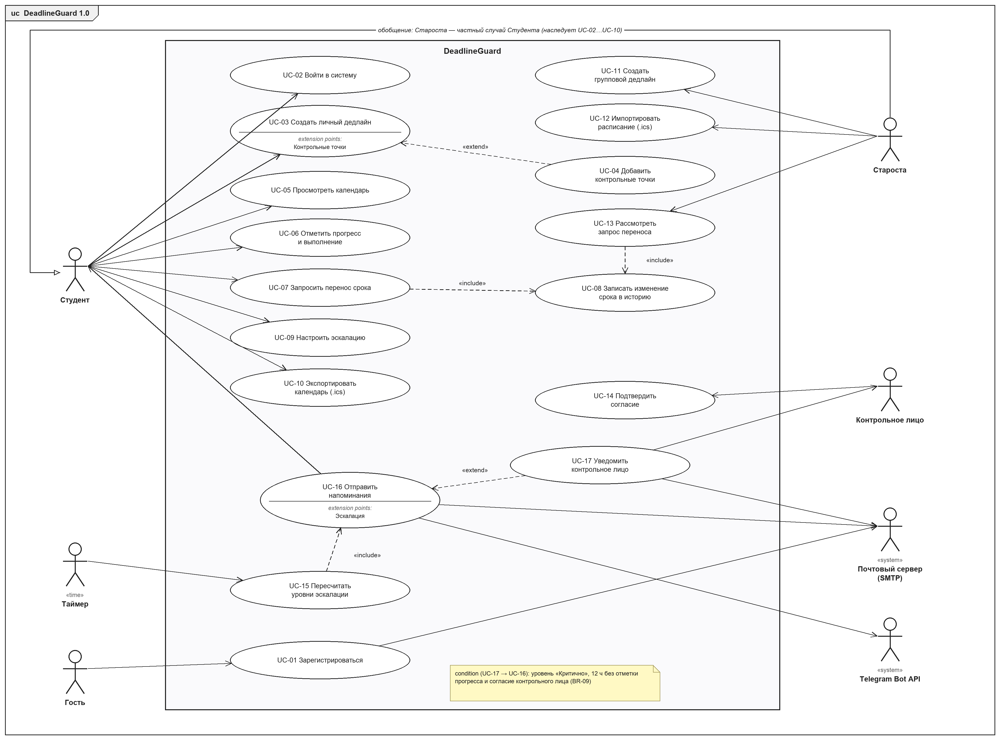

# Модель вариантов использования DeadlineGuard 1.0

Диаграмма — [`images/use-cases.png`](images/use-cases.png), текстовая модель PlantUML —
[`models/use-cases.puml`](models/use-cases.puml). Модель уточняет диаграмму SysML v2 из SRS (рисунок 2)
под объём версии 1.0, согласованный в ЛР4: сводка группы исключена, добавлены контрольные точки, таймер как
актёр и общий прецедент «Записать изменение срока». Термины — [`glossary.md`](glossary.md), бизнес-правила
`BR-NN` — [`supplementary-specification.md`](supplementary-specification.md).

## История изменений

| Name | Date | Reason For Changes | Version |
|------|------|--------------------|---------|
| Драко М. Д. | 09.11.2026 | Первая редакция: 6 актёров, 17 прецедентов, потоки событий (ЛР5) | 1.0 |

*Рисунок 1 — Диаграмма вариантов использования DeadlineGuard 1.0*

## 1. Актёры

| Актёр | Тип | Описание (роль в системе) |
|-------|-----|---------------------------|
| Гость | основной, человек | незарегистрированный посетитель; может только создать учётную запись и подтвердить e-mail |
| Студент | основной, человек | ведёт личные дедлайны, отмечает прогресс, переносит сроки по правилам и получает напоминания |
| Староста | основной, человек; обобщение Студента | студент с ролью GroupHead: дополнительно создаёт групповые дедлайны, импортирует расписание и решает запросы переноса своей группы |
| Контрольное лицо | основной, человек (без учётной записи) | выбранный студентом человек, который соглашается получать уведомления и получает их при эскалации |
| Таймер | основной, время | системные часы: раз в 5 минут запускают пересчёт уровней эскалации и рассылку напоминаний |
| Почтовый сервер (SMTP) | вспомогательный, система | внешний SMTP-сервер, доставляющий письма подтверждения и напоминания |
| Telegram Bot API | вспомогательный, система | внешний сервис Telegram, доставляющий критичные напоминания в мессенджер |

Связь обобщения «Староста → Студент» показана, потому что поведение старосты отличается: он инициирует
прецеденты UC-11…UC-13, недоступные обычному студенту. Других связей между актёрами нет — актёры находятся вне
системы.

## 2. Связи между прецедентами

| Связь | Откуда → куда | Смысл |
|-------|---------------|-------|
| «include» | UC-07 Запросить перенос срока → UC-08 Записать изменение срока | перенос всегда записывается в историю срока |
| «include» | UC-13 Рассмотреть запрос переноса → UC-08 Записать изменение срока | одобренный старостой перенос записывается той же процедурой |
| «include» | UC-15 Пересчитать уровни эскалации → UC-16 Отправить напоминания | после пересчёта всегда планируются напоминания |
| «extend» | UC-04 Добавить контрольные точки → UC-03 Создать личный дедлайн | точка расширения «Контрольные точки»: только для больших работ |
| «extend» | UC-17 Уведомить контрольное лицо → UC-16 Отправить напоминания | точка расширения «Эскалация»: условие BR-09 |

## 3. Описания прецедентов

### UC-01 Зарегистрироваться

- **Актёры:** Гость (основной), Почтовый сервер (вспомогательный).
- **Краткое описание:** гость создаёт учётную запись по e-mail и паролю и подтверждает e-mail по ссылке (REQ-FUNC-001).
- **Предусловия:** гость не вошёл в систему; e-mail ещё не зарегистрирован.
- **Основной поток:**
  1. Прецедент начинается, когда гость открывает страницу «Регистрация».
  2. Система показывает форму: e-mail, пароль, повтор пароля, номер группы.
  3. Гость заполняет форму и нажимает «Зарегистрироваться».
  4. Система проверяет данные. Если данные некорректны, выполняется поток А1; если e-mail занят — А2.
  5. Система сохраняет пользователя с хешем пароля BCrypt и признаком «e-mail не подтверждён».
  6. Система отправляет через почтовый сервер письмо со ссылкой подтверждения (действует 24 ч).
  7. Гость переходит по ссылке; система отмечает e-mail подтверждённым и предлагает войти.
  8. Прецедент завершается.
- **Альтернативные потоки:**
  - А1. Пароль короче 8 символов, без букв или цифр, пароли не совпадают — система показывает ошибку у поля, переход к шагу 3.
  - А2. E-mail уже зарегистрирован — система показывает «Учётная запись с таким e-mail уже существует», переход к шагу 3.
  - А3. Ссылка подтверждения просрочена — система предлагает отправить письмо повторно, переход к шагу 6.
- **Поток ошибки:** Е1. Почтовый сервер недоступен — учётная запись сохраняется, письмо ставится на повтор, гостю показывается «Письмо будет отправлено в течение нескольких минут».
- **Постусловия:** создана учётная запись с ролью STUDENT; после подтверждения e-mail пользователь может войти.

### UC-02 Войти в систему

- **Актёры:** Студент (в том числе Староста).
- **Краткое описание:** пользователь входит по e-mail и паролю и попадает в календарь (REQ-FUNC-001, REQ-SEC-002).
- **Предусловия:** учётная запись создана, e-mail подтверждён.
- **Основной поток:**
  1. Прецедент начинается, когда пользователь открывает страницу «Вход».
  2. Пользователь вводит e-mail и пароль и нажимает «Войти».
  3. Система проверяет, не заблокирован ли вход для e-mail (BR-16). Если заблокирован — поток А2.
  4. Система сверяет пароль с хешем. Если не совпадает — поток А1.
  5. Система сбрасывает счётчик неудачных попыток, создаёт сессию и открывает календарь.
  6. Прецедент завершается.
- **Альтернативные потоки:**
  - А1. Неверный e-mail или пароль — счётчик неудачных попыток увеличивается, показывается «Неверный e-mail или пароль» без уточнения; при пятой неудаче подряд вход блокируется на 15 минут. Переход к шагу 2.
  - А2. Вход заблокирован — показывается время до разблокировки, прецедент завершается.
  - А3. E-mail не подтверждён — показывается предложение отправить письмо повторно (UC-01, шаг 6).
- **Постусловия:** открыта сессия пользователя; событие входа записано в журнал.

### UC-03 Создать личный дедлайн

- **Актёры:** Студент.
- **Краткое описание:** студент создаёт дедлайн с жёстко зафиксированным сроком (REQ-FUNC-002, REQ-FUNC-004). Диаграммы: `activity-create-deadline`, `sequence-create-deadline`.
- **Предусловия:** пользователь вошёл в систему (UC-02).
- **Основной поток:**
  1. Прецедент начинается, когда студент нажимает «Новый дедлайн» в календаре.
  2. Система показывает форму: название, предмет, тип работы, срок (дата и время), трудоёмкость, каналы напоминаний; поле срока помечено значком замка с подсказкой «после сохранения срок изменить нельзя».
  3. Студент заполняет поля. **Точка расширения «Контрольные точки»** — для курсовой или другой большой работы выполняется UC-04.
  4. Студент нажимает «Сохранить».
  5. Система проверяет данные на сервере (BR-02, BR-03). Если есть ошибки — поток А1.
  6. Система сохраняет дедлайн, рассчитывает начальный уровень эскалации по сроку (BR-08) и записывает событие в журнал.
  7. Система открывает карточку дедлайна; дедлайн виден в календаре и, если подходит, в «Горящих дедлайнах» не позже 1 с.
  8. Прецедент завершается.
- **Альтернативные потоки:**
  - А1. Пустое название, срок в прошлом или трудоёмкость вне 0–200 ч — система возвращает форму с ошибками у полей и сохранёнными введёнными значениями, переход к шагу 3.
  - А2. Студент нажимает «Отмена» — данные не сохраняются, система возвращается в календарь.
  - А3. Студент открывает «Редактировать» у сохранённого дедлайна — система разрешает менять название, предмет, тип и каналы; при попытке передать другой срок запрос отклоняется с HTTP 409 «Срок изменяется только запросом переноса» (BR-01).
- **Постусловия:** дедлайн сохранён со статусом «активен» и уровнем по оставшемуся времени; срок заблокирован для прямого изменения.

### UC-04 Добавить контрольные точки

- **Актёры:** Студент.
- **Краткое описание:** расширение UC-03: к большой работе добавляются до 5 промежуточных сроков (REQ-FUNC-018).
- **Предусловия:** выполняется UC-03 в точке расширения «Контрольные точки».
- **Основной поток:**
  1. Студент нажимает «Добавить контрольную точку».
  2. Система добавляет строку: название и дата-время точки.
  3. Студент заполняет строку; шаги 1–3 повторяются, пока точек меньше 5.
  4. Студент возвращается к шагу 4 прецедента UC-03.
- **Альтернативные потоки:**
  - А1. Точек уже 5 — кнопка «Добавить» недоступна.
  - А2. Точка позже срока дедлайна — при сохранении ошибка у поля точки (BR-03).
- **Постусловия:** точки сохраняются вместе с дедлайном; уровень эскалации считается по ближайшей невыполненной точке.

### UC-05 Просмотреть календарь

- **Актёры:** Студент.
- **Краткое описание:** студент видит дедлайны месяца с цветом и меткой уровня и панель «Горящие дедлайны» (REQ-FUNC-003).
- **Предусловия:** пользователь вошёл в систему.
- **Основной поток:**
  1. Прецедент начинается после входа или при выборе пункта «Календарь».
  2. Система показывает сетку текущего месяца: в ячейках — дедлайны и контрольные точки с цветом и меткой уровня.
  3. Система показывает «Горящие дедлайны» — до 5 невыполненных дедлайнов с наименьшим оставшимся временем.
  4. Студент листает месяцы или выбирает дедлайн; система открывает карточку с прогрессом и историей срока.
  5. Прецедент завершается.
- **Альтернативные потоки:**
  - А1. Ширина экрана < 600 px — календарь показывается списком по датам.
  - А2. Студент открывает центр уведомлений — система показывает последние 50 уведомлений и сбрасывает счётчик непрочитанных.
  - А3. Студент открывает чужой дедлайн по прямой ссылке — HTTP 403 (BR-15).
- **Постусловия:** данные не изменяются.

### UC-06 Отметить прогресс и выполнение

- **Актёры:** Студент.
- **Краткое описание:** студент отмечает процент выполнения или «Сдано»; напоминания перестраиваются (REQ-FUNC-008).
- **Предусловия:** открыта карточка своего невыполненного или выполненного менее 24 ч назад дедлайна.
- **Основной поток:**
  1. Студент выбирает процент (0–100 с шагом 10) и нажимает «Отметить».
  2. Система сохраняет прогресс и время отметки; таймер эскалации сбрасывается, уровень «Эскалация» возвращается в «Критично» (BR-09).
  3. Студент нажимает «Сдано» — система переводит дедлайн в уровень «Выполнен», напоминания прекращаются.
  4. Прецедент завершается.
- **Альтернативные потоки:**
  - А1. Студент нажимает «Отменить отметку» в течение 24 ч — система снимает отметку и пересчитывает уровень по оставшемуся времени (BR-10).
  - А2. Прошло больше 24 ч — кнопка «Отменить отметку» недоступна.
- **Постусловия:** прогресс и время отметки сохранены; у выполненного дедлайна нет запланированных напоминаний.

### UC-07 Запросить перенос срока

- **Актёры:** Студент.
- **Краткое описание:** студент переносит срок с обязательной причиной: личный — сразу, групповой — после решения старосты (REQ-FUNC-009). Диаграммы: `activity-postponement`, `sequence-postponement`.
- **Предусловия:** открыта карточка своего невыполненного дедлайна.
- **Основной поток:**
  1. Студент нажимает «Запросить перенос».
  2. Система показывает форму: новый срок, причина (10–500 символов), число оставшихся переносов.
  3. Студент заполняет форму и нажимает «Отправить».
  4. Система проверяет причину и новый срок (BR-04, новый срок позже текущего момента). При ошибке — поток А1.
  5. Дедлайн личный: система проверяет лимит переносов (BR-05). Если лимит исчерпан — поток А2.
  6. Система применяет новый срок и выполняет UC-08 «Записать изменение срока».
  7. Система пересчитывает уровень эскалации и показывает карточку с обновлённой историей срока.
  8. Прецедент завершается.
- **Альтернативные потоки:**
  - А1. Причина короче 10 символов или новый срок в прошлом — ошибка у поля, переход к шагу 3.
  - А2. Третий перенос личного дедлайна — сообщение «Лимит переносов исчерпан (2 из 2)», срок не меняется.
  - А3. Дедлайн групповой — система сохраняет запрос со статусом «ожидает», уведомляет старосту и показывает студенту «Запрос отправлен старосте»; срок меняется в UC-13.
- **Постусловия:** личный дедлайн имеет новый срок и запись в истории; для группового создан запрос со статусом «ожидает».

### UC-08 Записать изменение срока

- **Актёры:** — (включаемый прецедент, вызывается из UC-07 и UC-13).
- **Краткое описание:** общий фрагмент поведения: изменение срока и запись в историю в одной транзакции (BR-07).
- **Предусловия:** изменение срока разрешено вызывающим прецедентом.
- **Основной поток:**
  1. Система создаёт запись истории: дата изменения, старый срок, новый срок, автор, причина.
  2. Система устанавливает новый срок дедлайна и увеличивает счётчик переносов.
  3. Обе операции фиксируются одной транзакцией.
- **Альтернативные потоки:** А1. Одновременное изменение дедлайна (конфликт версии `@Version`) — транзакция откатывается, пользователю предлагается обновить страницу.
- **Постусловия:** история срока содержит новую запись; прямое изменение срока по-прежнему запрещено.

### UC-09 Настроить эскалацию

- **Актёры:** Студент, Почтовый сервер.
- **Краткое описание:** студент выбирает каналы, тихие часы и контрольное лицо; пороги показаны только для чтения (REQ-FUNC-010).
- **Предусловия:** пользователь вошёл в систему.
- **Основной поток:**
  1. Студент открывает «Настройки эскалации».
  2. Система показывает каналы, тихие часы, контрольное лицо и пороги уровней (только чтение).
  3. Студент меняет каналы и тихие часы, указывает e-mail контрольного лица и нажимает «Сохранить».
  4. Система сохраняет настройки; при новом контрольном лице отправляет ему письмо с запросом согласия (UC-14).
  5. Прецедент завершается.
- **Альтернативные потоки:** А1. «По умолчанию» — система восстанавливает каналы и тихие часы 23:00–08:00. А2. Студент отключает все каналы — канал «в приложении» остаётся включённым.
- **Постусловия:** настройки применяются к следующим запланированным напоминаниям.

### UC-10 Экспортировать календарь

- **Актёры:** Студент.
- **Краткое описание:** выгрузка невыполненных дедлайнов и контрольных точек в файл .ics (REQ-FUNC-013).
- **Предусловия:** пользователь вошёл в систему.
- **Основной поток:**
  1. Студент нажимает «Экспорт .ics».
  2. Система формирует файл RFC 5545: по одному событию VEVENT на каждый невыполненный дедлайн и контрольную точку, с UID и временем в UTC.
  3. Браузер скачивает файл `deadlineguard.ics`.
- **Альтернативные потоки:** А1. Невыполненных дедлайнов нет — выгружается пустой календарь без событий.
- **Постусловия:** данные не изменяются.

### UC-11 Создать групповой дедлайн

- **Актёры:** Староста.
- **Краткое описание:** староста создаёт дедлайн, который появляется у всех студентов группы (REQ-FUNC-011).
- **Предусловия:** пользователь вошёл с ролью GroupHead своей группы.
- **Основной поток:**
  1. Староста открывает «Группа → Новый групповой дедлайн».
  2. Система показывает форму, как в UC-03, без контрольного лица.
  3. Староста заполняет форму и нажимает «Сохранить».
  4. Система проверяет данные (BR-02), сохраняет шаблон группового дедлайна и создаёт копию у каждого студента группы.
  5. Система показывает «Дедлайн создан у N студентов».
- **Альтернативные потоки:** А1. Ошибки в данных — как А1 UC-03.
- **Постусловия:** у каждого студента группы есть дедлайн, срок которого может изменить только староста.

### UC-12 Импортировать расписание

- **Актёры:** Староста.
- **Краткое описание:** групповые дедлайны создаются из файла .ics до 1 МБ без дублей (REQ-FUNC-012, итерация I4).
- **Предусловия:** пользователь вошёл с ролью GroupHead.
- **Основной поток:**
  1. Староста выбирает файл .ics и нажимает «Импортировать».
  2. Система разбирает события и для каждого ищет дубль по UID (при отсутствии UID — по названию и дате).
  3. Для новых событий выполняются шаги 4–5 UC-11.
  4. Система показывает отчёт «создано N, пропущено M (причины)».
- **Альтернативные потоки:** А1. Файл больше 1 МБ или не .ics — сообщение об ошибке, импорт не выполняется.
- **Постусловия:** созданы групповые дедлайны для новых событий.

### UC-13 Рассмотреть запрос переноса

- **Актёры:** Староста.
- **Краткое описание:** староста одобряет или отклоняет запрос переноса группового дедлайна (REQ-FUNC-009, BR-06).
- **Предусловия:** есть запрос со статусом «ожидает» от студента группы старосты.
- **Основной поток:**
  1. Староста открывает «Группа → Запросы переноса».
  2. Система показывает запросы: студент, дедлайн, текущий и новый срок, причина.
  3. Староста нажимает «Одобрить».
  4. Система выполняет UC-08 «Записать изменение срока» с автором-старостой, пересчитывает уровень и уведомляет студента о решении.
  5. Прецедент завершается.
- **Альтернативные потоки:** А1. Староста нажимает «Отклонить» — запрос получает статус «отклонён», срок не меняется, студент получает уведомление. А2. Запрос открыт не старостой этой группы — HTTP 403 (BR-15).
- **Постусловия:** запрос имеет статус «одобрен» или «отклонён»; студент уведомлён.

### UC-14 Подтвердить согласие контрольного лица

- **Актёры:** Контрольное лицо.
- **Краткое описание:** контрольное лицо по ссылке из письма соглашается получать уведомления или отказывается (REQ-SEC-004, итерация I3).
- **Предусловия:** студент указал контрольное лицо (UC-09); письмо отправлено.
- **Основной поток:**
  1. Контрольное лицо переходит по ссылке из письма.
  2. Система показывает, кто и зачем его выбрал, и кнопки «Согласен» и «Отказаться».
  3. Контрольное лицо нажимает «Согласен»; система сохраняет согласие и уведомляет студента.
- **Альтернативные потоки:** А1. «Отказаться» — согласие отозвано, студент видит предупреждение. А2. Ссылка недействительна — сообщение об ошибке.
- **Постусловия:** статус согласия — «дано» или «отозвано».

### UC-15 Пересчитать уровни эскалации

- **Актёры:** Таймер.
- **Краткое описание:** раз в 5 минут система пересчитывает уровень каждого активного дедлайна (REQ-FUNC-005). Диаграмма: `state-deadline`.
- **Предусловия:** приложение запущено; задача не выполняется другим экземпляром (ShedLock).
- **Основной поток:**
  1. Прецедент начинается по сигналу таймера каждые 5 минут.
  2. Система выбирает активные дедлайны пакетами по 500.
  3. Для каждого дедлайна система определяет цель эскалации и уровень по BR-08 и BR-09.
  4. Если уровень изменился — система сохраняет его и выполняет UC-16 «Отправить напоминания».
  5. Прецедент завершается после обработки последнего пакета.
- **Альтернативные потоки:** А1. Блокировка ShedLock занята — цикл пропускается. А2. Конфликт версии с действием пользователя — дедлайн пересчитывается в следующем цикле.
- **Постусловия:** уровни всех активных дедлайнов соответствуют текущему времени с точностью до 5 минут.

### UC-16 Отправить напоминания

- **Актёры:** Студент (получатель), Почтовый сервер, Telegram Bot API (вспомогательные).
- **Краткое описание:** напоминания уровня планируются в outbox и доставляются по каналам с повторами (REQ-FUNC-006, REQ-REL-001…003, итерация I3). Диаграмма: `state-reminder`, SDD 005.
- **Предусловия:** уровень дедлайна определён; каналы включены пользователем.
- **Основной поток:**
  1. Система записывает в outbox напоминания по расписанию уровня для каждого включённого канала.
  2. Обработчик outbox раз в 60 с выбирает созревшие напоминания.
  3. Система отправляет напоминание: в приложении — в центр уведомлений, e-mail — через почтовый сервер, Telegram — через Bot API.
  4. При успехе напоминание помечается «отправлено». **Точка расширения «Эскалация»** — при условии BR-09 выполняется UC-17.
- **Альтернативные потоки:** А1. Тихие часы и уровень ниже «Критично» — отправка откладывается до конца тихих часов (BR-12). А2. Ошибка канала — повтор через 1, 5, 25 мин; после 3 неудач Telegram — отправка на e-mail (BR-13).
- **Постусловия:** каждое напоминание доставлено не более одного раза по каждому каналу (BR-14) и записано в журнал.

### UC-17 Уведомить контрольное лицо

- **Актёры:** Контрольное лицо (получатель), Почтовый сервер.
- **Краткое описание:** расширение UC-16: однократное уведомление контрольному лицу при эскалации (REQ-FUNC-007, итерация I3).
- **Предусловия:** дедлайн в уровне «Критично» 12 ч без отметки прогресса; контрольное лицо дало согласие.
- **Основной поток:**
  1. Система формирует письмо: название работы, срок, последний прогресс, ссылка для отказа.
  2. Система отправляет письмо и помечает, что уведомление по этой цели эскалации отправлено.
- **Альтернативные потоки:** А1. Согласия нет — напоминание получает статус «пропущено», студенту показывается предупреждение.
- **Постусловия:** контрольное лицо уведомлено один раз на цель эскалации.

## 4. Соответствие прецедентов диаграммам и итерациям

| Прецедент | Активность | Состояния | Последовательность | Итерация |
|-----------|------------|-----------|--------------------|----------|
| UC-01, UC-02 | — | — | — | I1 |
| UC-03, UC-04 | `activity-create-deadline` | `state-deadline` (начальный уровень) | `sequence-create-deadline` | I1, точки — I3 |
| UC-05, UC-06 | — | `state-deadline` | — | I2 |
| UC-07, UC-08, UC-13 | `activity-postponement` | `state-deadline` (повторный вход в Active) | `sequence-postponement` | I2 |
| UC-09, UC-14, UC-17 | — | `state-reminder` | SDD 005 | I3–I4 |
| UC-10 | — | — | — | I1 |
| UC-11, UC-12 | — | — | — | I2, импорт — I4 |
| UC-15, UC-16 | — | `state-deadline`, `state-reminder` | SDD 005 | I2–I3 |
